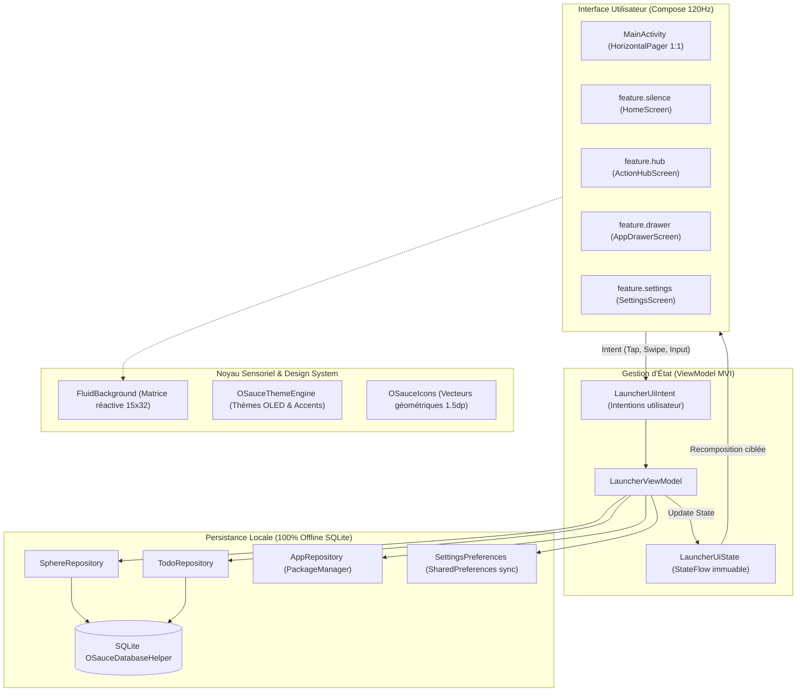

# Architecture Technique OSauce Launcher

Architecture logicielle native Android (Kotlin 2.0 & Jetpack Compose), MVI unidirectionnel, persistance 100% hors-ligne SQLite.

---

## 1. Modèle Architectural Global (MVI Unidirectionnel)

---

## 2. Découpage des Modules

### 2.1 Couche Présentation (`feature/`)
* **`feature.silence`** : Écran d'accueil épuré. Horloge géante Space Grotesk, indicateur batterie discret Canvas, dock 4 essentiels.
* **`feature.hub`** : Dashboard des Sphères de Vie (Humains, Travail, Vital, Loisirs), barre de capture rapide, liste de tâches avec physique de ressort (*spring*) et gestes de swipe.
* **`feature.drawer`** : Tiroir d'applications alphabétique A-Z. Rendu monochrome GPU (`ColorMatrix`) neutralisant les couleurs dopaminergiques.
* **`feature.settings`** : Contrôles de la matrice réactive (vibrance, morphologie, densité), sélecteur de thèmes OLED, définition du launcher par défaut (`ACTION_HOME_SETTINGS`).

### 2.2 Noyau Graphique (`core/designsystem/`)
* **`FluidBackground.kt`** : Rendu GPU matériel via BitmapShader 1 seul appel drawPaint. Interpolation continue 120Hz sans allocation mémoire dans le cycle de rendu.
* **`OSauceIcons.kt`** : Icônes sur-mesure dessinées en courbes de Bézier vectorielles pures. Zéro emoji et zéro artifice textuel.

### 2.3 Persistance Déterministe (`data/`)
* **Base de données SQLite** :
  - Table `spheres` : id, nom, icône, couleur hexadécimale, ordre de tri, applications associées (JSON string).
  - Table `todos` : id, id_sphere, titre, notes, statut complété, priorité, horodatage.
* **Intégrité hors-ligne** : Aucune dépendance réseau. Sauvegarde synchrone et réactivité via Kotlin StateFlows.
