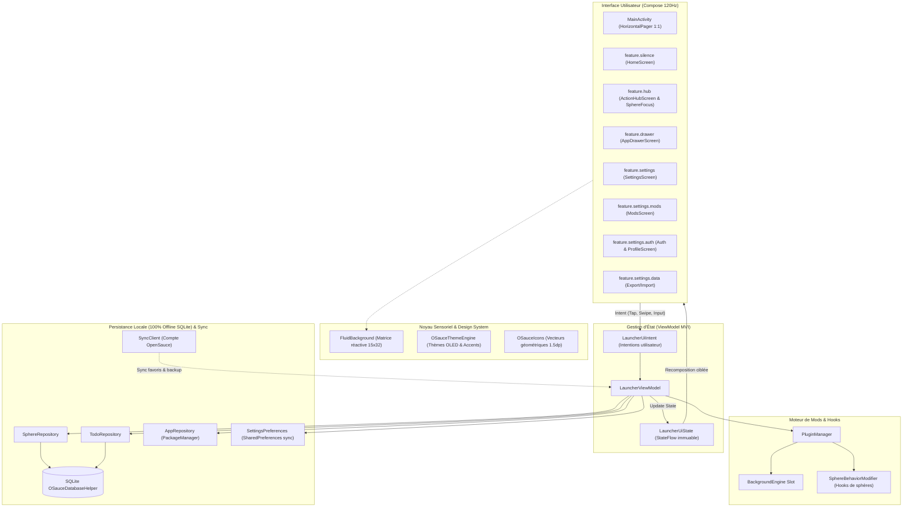

# Architecture Technique OSauce Launcher

Architecture logicielle native Android (Kotlin 2.0 & Jetpack Compose), MVI unidirectionnel, persistance 100% hors-ligne SQLite et moteur de mods ouvert.

---

## 1. Modèle Architectural Global (MVI Unidirectionnel)

---

## 2. Découpage des Modules

### 2.1 Couche Présentation (`feature/`)
* **`feature.silence`** : Écran d'accueil épuré. Horloge géante Space Grotesk, indicateur batterie discret Canvas, dock 4 essentiels.
* **`feature.hub`** : Dashboard des Sphères de Vie (Humains, Travail, Vital, Loisirs), vue focus étanche, barre de capture rapide, liste de tâches avec physique de ressort (*spring*) et gestes de swipe.
* **`feature.drawer`** : Tiroir d'applications alphabétique A-Z. Rendu monochrome GPU (`ColorMatrix`) neutralisant les couleurs dopaminergiques, badges de sphère.
* **`feature.settings`** : 
  - `SettingsScreen.kt` : Hub des réglages en 8 sections.
  - `mods/ModsScreen.kt` : Gestion des mods installés et exploration du catalogue.
  - `auth/AuthScreen.kt` & `ProfileScreen.kt` : Connexion, profil et espace créateur.
  - `data/DataScreen.kt` : Exportation/Importation de sauvegardes JSON et purge locale.

### 2.2 Moteur de Mods & Plugins (`plugin/`)
* **`BackgroundEngine`** : Slot modulaire pour l'arrière-plan interactif (The Sauce natif ou moteur alternatif).
* **`SphereBehaviorModifier`** : Points d'ancrage (*Hooks*) permettant à un mod d'altérer la logique des sphères (auto-planning horaire, app locker strict, filtrage des notifications, sync externe Markdown).

### 2.3 Noyau Graphique (`core/designsystem/`)
* **`FluidBackground.kt`** : Rendu GPU matériel via BitmapShader en 1 seul appel drawPaint. Interpolation continue 120Hz sans allocation mémoire dans le cycle de rendu.
* **`OSauceIcons.kt`** : Icônes sur-mesure dessinées en courbes de Bézier vectorielles pures. Zéro emoji et zéro artifice textuel.

### 2.4 Persistance Déterministe (`data/`)
* **Base de données SQLite** :
  - Table `spheres` : id, nom, icône, couleur hexadécimale, ordre de tri, applications associées (JSON string).
  - Table `todos` : id, id_sphere, titre, notes, statut complété, priorité, horodatage.
* **Intégrité hors-ligne** : Le mode invité ne requiert aucune connexion. Sauvegarde synchrone et réactivité via Kotlin StateFlows.
