# Cadrage Pré-Prototype — OSauce (O.Sauce)

l'Elevator Pitch, l'Arbre Fonctionnel complet,et la Maquette Fonctionnelle détaillée écran par écran.

---

## 1. Elevator Pitch

### Version 30 Secondes (Le Hook & La Solution)
> « Saviez-vous qu'un utilisateur consulte son téléphone 150 fois par jour et reçoit plus de 80 notifications conçues pour capter sa dopamine ? Les dumbphones coupent du monde moderne (adieu WhatsApp, bancaire ou billets de train), et les surcouches Android actuelles pèsent des gigaoctets.
> **OSauce**, c'est le premier launcher mobile éco-conçu qui transforme votre smartphone en un outil sobre, fluide à 120 Hz et anti-distraction : un écran d'accueil noir OLED pur avec seulement vos 4 essentiels, un Action Hub qui regroupe vos tâches par sphères de vie, et zéro algorithme captif. Gardez vos applications utiles, reprenez le contrôle de votre temps. »

### Version 60 Secondes (Investisseur / Démo)
> « Aujourd'hui, les jeunes actifs et étudiants sont pris en étau : d'un côté, des smartphones saturés de bloatwares et de notifications invasives qui ruinent leur concentration et vident leur batterie ; de l'autre, des dumbphones rétrogrades incompatibles avec la vie quotidienne.
> 
> **Notre réponse : OSauce.** 
> Une interface Android radicalement épurée et ultra-rapide (60/120 FPS constant) construite sur 3 piliers :
> 1. **Le Silence :** un écran d'accueil OLED qui n'affiche que l'heure typographique et 4 tuiles tactiles personnalisables.
> 2. **L'Action Hub :** un espace unifié qui classe les flux par sphères (Études, Pro, Personnel) plutôt qu'en alertes anxiogènes.
> 3. **La Durabilité & l'Éco-conception (ODD 12 & 3) :** aucun tracking, consommation énergétique minimale pour prolonger la durée de vie des appareils de 2 à 3 ans.
> 
> OSauce, c'est la puissance d'un smartphone moderne avec la quiétude d'un carnet papier. »

---

## 2. Arbre Fonctionnel (Functional Tree)

```mermaid
graph TD
    Root["OSauce Launcher"] --> S1["Écran 1 : Silence (Home)"]
    Root --> S2["Écran 2 : Action Hub (Swipe Gauche / Droite)"]
    Root --> S3["Écran 3 : App Drawer (Swipe Haut)"]
    Root --> S4["Écran 4 : Paramètres & Personnalisation (Long Press)"]

    %% Écran 1
    S1 --> S1_Clock["Hero Clock (Typographie géante, date sobre)"]
    S1 --> S1_Matrix["Matrice Interactive (Cellules tactiles 120Hz)"]
    S1 --> S1_Tiles["Grille des 4 Essentiels (Téléphone, Messages, Outil clé, Note)"]
    S1 --> S1_Dock["Dock Minimal (Accès rapide caméra / silence)"]

    %% Écran 2
    S2 --> S2_Spheres["Sélecteur de Sphères (Perso / Études / Travail)"]
    S2 --> S2_Feed["Flux d'Actions Unifié (Todo + Notifs regroupées)"]
    S2 --> S2_Batch["Traitement par lot (Tout marquer lu / Reporter)"]

    %% Écran 3
    S3 --> S3_Search["Champ de recherche instantané (Zéro latence)"]
    S3 --> S3_List["Liste alphabétique verticale épurée (Icônes monochromes)"]
    S3 --> S3_Filter["Filtre rapide par initiale"]

    %% Écran 4
    S4 --> S4_Launcher["Définir comme launcher par défaut"]
    S4 --> S4_Theme["Rendu Matrice (Rounded Square, Organic Cell, Cross Matrix)"]
    S4 --> S4_Colors["Palette Pastels & Noir OLED"]
    S4 --> S4_Modules["Gestion des plugins / modules"]
```



### Détail des Flux et Interactions

| Écran | Déclencheur (Trigger) | Transition Apple Design | Action Utilisateur |
|---|---|---|---|
| **Silence $\rightarrow$ Action Hub** | Swipe horizontal (droite à gauche) | Spring fluide (`response: 0.35s`, `damping: 0.9`), translation X continue | Consultation des tâches et notifications par sphère |
| **Silence $\rightarrow$ App Drawer** | Swipe vertical (bas vers haut) | Drawer avec friction progressive (rubber-banding), fade de l'horloge | Recherche rapide ou ouverture d'une app secondaire |
| **App Drawer $\rightarrow$ Silence** | Swipe vers le bas ou touche Retour | Retour élastique symétrique | Retour instantané au calme |
| **Silence $\rightarrow$ Settings** | Long press (500ms) sur zone vide | Micro-haptique + expansion douce depuis le point d'appui | Ajustement du thème et de la matrice |

---

## 3. Maquette Fonctionnelle (Wireframes Textuels)

### Écran 1 — Le Silence (Accueil Minimaliste)
```text
+-----------------------------------+
|  100% [=]             09:41  (O)  |  <- Barre d'état minimaliste
|                                   |
|                                   |
|              09:41                |  <- Hero Clock (68px, Light 300)
|       Mercredi 4 Novembre         |  <- Date sobre (13px, Muted #8E8E93)
|                                   |
|   +---------------------------+   |
|   |   MATRICE INTERACTIVE     |   |  <- Fond interactif 120Hz
|   |   (Rendu tactile fluide)  |   |     (Réagit subtilement au toucher)
|   +---------------------------+   |
|                                   |
|   +-----------+   +-----------+   |
|   | Téléphone |   | Messages  |   |  <- 4 Tuiles Essentielles (Haptique 1:1)
|   +-----------+   +-----------+   |     Conteneurs sombres #121212
|   +-----------+   +-----------+   |     Bordure fine 1px #2C2C2E
|   | Calendrier|   | Notes     |   |
|   +-----------+   +-----------+   |
|                                   |
|            - - - - -              |  <- Indicateur de swipe discret (Drawer)
+-----------------------------------+
```

### Écran 2 — Action Hub & Sphères de Vie
```text
+-----------------------------------+
| < SILENCE            SPHÈRES      |  <- Header de navigation
|                                   |
|  [ ETUDES ]  [ PERSO ]  [ PRO ]   |  <- Onglets Sphères (Pill badges)
|                                   |
|  ACTIONS DU JOUR (3)              |  <- Section titre (12px CAPS #8E8E93)
|  +-----------------------------+  |
|  | [o] Rendre TP Kotlin  14:00 |  |  <- Tâche prioritaire
|  +-----------------------------+  |
|  | [o] Billet train SNCF 18:30 |  |
|  +-----------------------------+  |
|                                   |
|  NOTIFICATIONS REGROUPÉES (2)     |  <- Flux asynchrone non intrusif
|  +-----------------------------+  |
|  | WhatsApp (Groupe Promo)     |  |  <- Regroupement silencieux
|  | 4 messages résumés          |  |
|  +-----------------------------+  |
|                                   |
|  [ V Tout marquer comme vu ]      |  <- Bouton désencombrement instantané
+-----------------------------------+
```

### Écran 3 — App Drawer (Tiroir d'Applications)
```text
+-----------------------------------+
|  [Q Rechercher une application...] |  <- Input instantané avec auto-focus
|                                   |
|  A                                |  <- Séparateur alphabétique
|    Appareil photo                 |  <- Entrée texte + icône fine monochrome
|    Assistant SNCF                 |
|                                   |
|  B                                |
|    Banque                         |
|                                   |
|  C                                |
|    Calculatrice                   |
|    Chrome                         |
|                                   |
|                          A-Z Bar  |  <- Ruban tactile d'accès rapide
+-----------------------------------+
```

---
