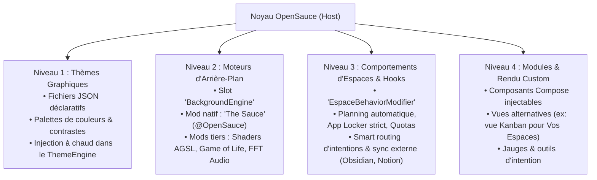
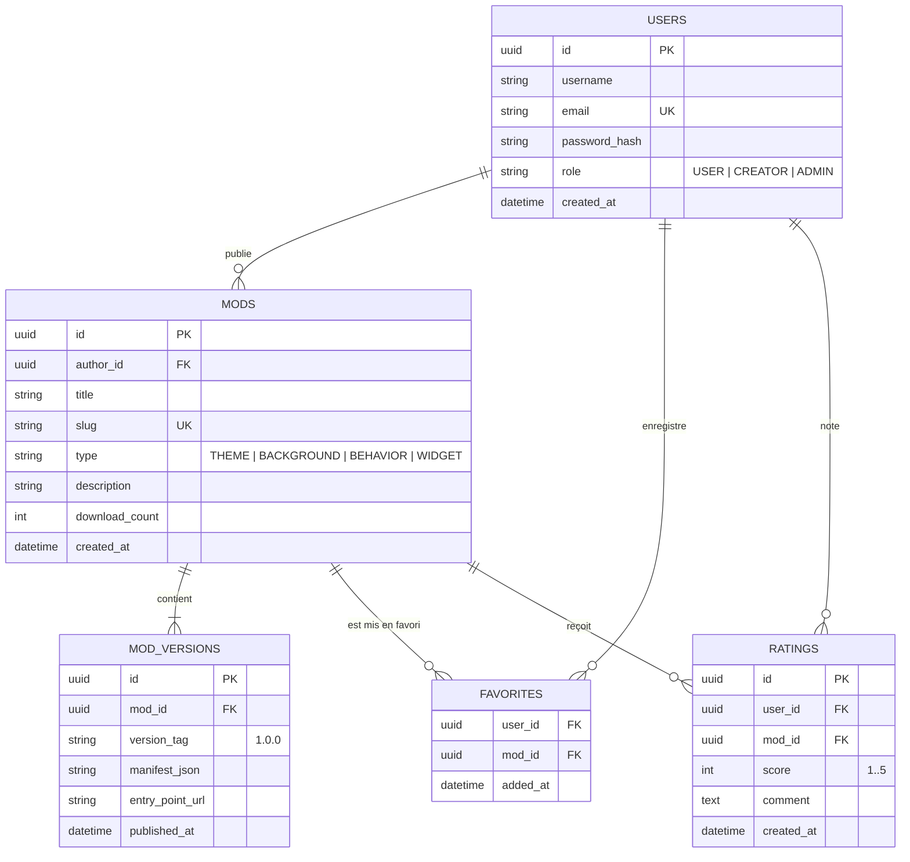

# OSauce — Modding, Extensions & Architecture Ouverte

OpenSauce est conçu nativement comme une plateforme extensible : chaque sous-système (arrière-plan, logique des espaces, thèmes, flux d'intentions) repose sur des interfaces et des points d'ancrage (*Hooks*) ouverts aux créateurs. Tous les mods officiels du projet sont signés par l'auteur officiel **`@OpenSauce`**.

---

## 1. Philosophie du Modding Comportemental
Dans OSauce, les mods ne se limitent pas à des widgets passifs ou à des ajustements cosmétiques.  
Un mod peut **étendre ou modifier en profondeur le comportement du lanceur** sans nécessiter de forker le projet :
* **Décorrélation Moteur $\leftrightarrow$ Logique** : Les espaces et les flux d'intentions exécutent une chaîne de règles modifiable par des plugins.
* **Respect de la vie privée** : Mode local par défaut (zéro compte obligatoire, base SQLite sur l'appareil).
* **Compte Créateur OpenSauce** : Permet de signer et publier ses extensions, sauvegarder ses configurations et synchroniser ses favoris.

---

## 2. Les 4 Niveaux d'Extensions



### Niveau 1 : Thèmes Graphiques (JSON No-Code)
Définition déclarative des couleurs d'accent, surfaces et contrastes.  
L'utilisateur peut importer un thème par simple copier-coller ou chargement d'un fichier `.json` :
```json
{
  "id": "theme_nordic_frost",
  "name": "Nordic Frost",
  "author": "@OpenSauce",
  "version": "1.0",
  "colors": {
    "background": "#0F141C",
    "surface": "#1A2230",
    "border": "#2E3C54",
    "textPrimary": "#ECEFF4",
    "textSecondary": "#7B8EA6",
    "primaryAccent": "#88C0D0",
    "secondaryAccent": "#81A1C1",
    "elevated": "#243044"
  },
  "vibrancy": "SUBTLE"
}
```

### Niveau 2 : Moteurs d'Arrière-Plan (Slot `BackgroundEngine`)
L'arrière-plan du lanceur est un emplacement interchangeable :
* **`The Sauce` (`InteractiveBackground.kt`) par `@OpenSauce`** : **Mod natif de référence**, pré-embarqué dans l'application. Calcule en temps réel une matrice de 480 cellules réactive aux vortex d'ondes, aux contacts tactiles et à la traînée continue (*Drag Trail*).
* **Mods tiers compatibles** : Tout créateur peut implémenter `BackgroundEngine` pour proposer son propre rendu :
  - Automates cellulaires interactifs (*Game of Life* par `@OpenSauce` ou tiers).
  - Shaders AGSL liquides (Android 13+ via `RenderEffect`).
  - Visualiseur audio réactif en temps réel.

### Niveau 3 : Mods Comportementaux (Hooks d'Espaces & Pipelines)
Point d'ancrage central permettant d'altérer la logique interne des Espaces et des intentions :
```kotlin
interface EspaceBehaviorModifier {
    // 1. Filtrer ou restreindre les applications d'un espace (ex: App Locker)
    fun filterAllowedApps(espace: Espace, apps: List<AppItem>): List<AppItem> = apps

    // 2. Intercepter l'activation d'un espace (ex: planification horaire, géolocalisation)
    fun onEspaceSelected(espace: Espace) {}

    // 3. Règles de filtrage des alertes (ex: mode silencieux strict par domaine)
    fun shouldMuteNotification(espace: Espace, notification: NotificationItem): Boolean = false

    // 4. Action personnalisée sur les intentions (ex: synchro avec un fichier Markdown local Obsidian)
    fun onIntentionCompleted(intention: IntentionItem) {}
}
```
**Exemples d'applications concrètes :**
* *Auto-Planning* : Activation automatique de l'espace *Travail* du lundi au vendredi de 9h à 18h, bascule sur *Loisirs* le soir.
* *Deep Focus Locker* : Blocage strict de l'ouverture d'applications de réseaux sociaux tant que l'espace Travail est actif.
* *Sync Obsidian / Notion* : Écriture instantanée des intentions cochées dans un fichier Markdown local.

### Niveau 4 : Vues Alternatives & Widgets
Permet de remplacer la présentation visuelle de l'écran Vos Espaces (ex: vue Kanban par colonnes au lieu de la grille 2 colonnes) ou d'insérer des jauges de suivi d'objectifs dans le Silence Screen.

---

## 3. Le Système de Compte OpenSauce & Schéma SQL

Pour les créateurs et les utilisateurs souhaitant synchroniser leurs configurations, une base relationnelle SQL structure l'écosystème :

### 3.1 Rôles & Accès
* **Invité (Local)** : Accès complet au lanceur, base SQLite locale sur le téléphone, zéro réseau.
* **Utilisateur (`USER`)** : Sauvegarde dans le cloud chiffré de ses espaces et synchronisation de ses mods favoris.
* **Créateur (`CREATOR` / `ADMIN`)** : Publication de thèmes, de moteurs d'arrière-plan et d'extensions avec gestion des versions (badge `@OpenSauce` pour les composants officiels).

### 3.2 Schéma Relationnel SQL


