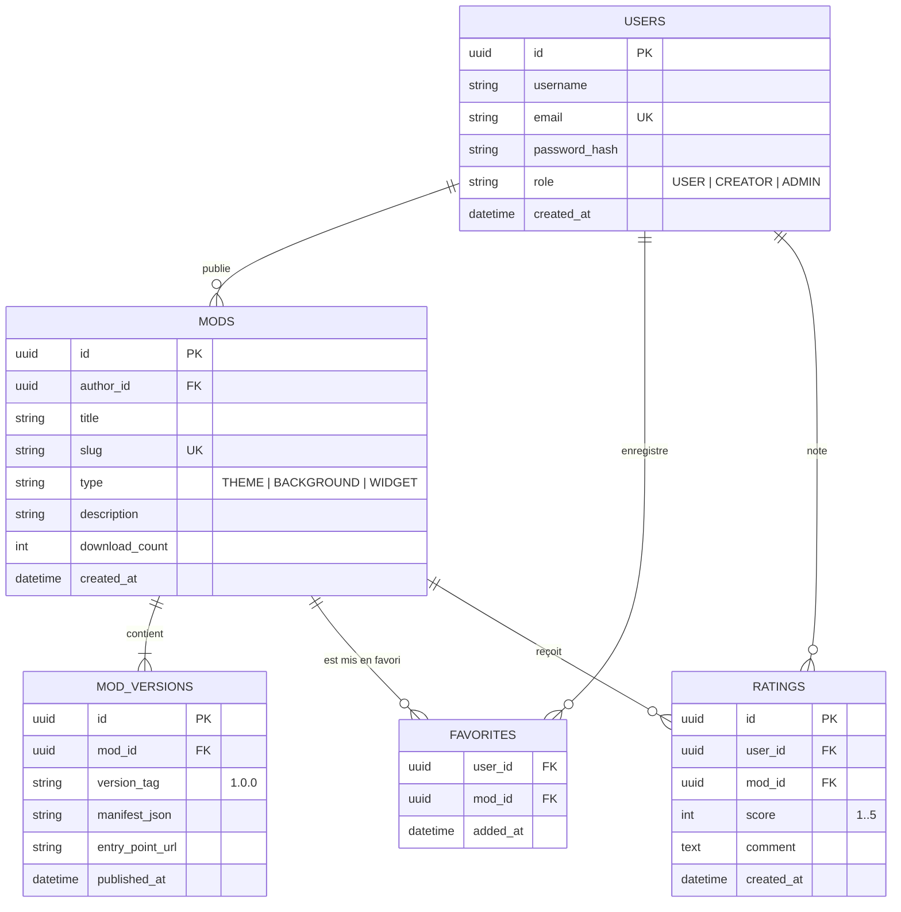

# OSauce — Modding, Extensions & Comptes Créateurs

Guide de la modularité d'OpenSauce : architecture des extensions, moteurs d'arrière-plan et gestion des comptes utilisateurs.

---

## 1. Philosophie du Modding
Le système de modding d'OSauce repose sur trois principes :
1. **Mode Invité / Local par défaut** : N'importe qui peut installer l'application et l'utiliser sans créer de compte (stockage 100% SQLite local sur l'appareil).
2. **Modularité par "Slots"** : Les composants clés du lanceur (thèmes, arrière-plan réactif) sont conçus comme des emplacements interchangeables.
3. **Compte OpenSauce pour les créateurs** : Un système d'authentification pour publier ses créations, synchroniser ses favoris et ses réglages entre appareils.

---

## 2. Niveaux de Mods & Le Cas d'`InteractiveBackground`

### Niveau 1 : Thèmes Graphiques (JSON No-Code)
Fichier JSON déclarant les couleurs d'accent, surfaces et contrastes, injecté dynamiquement dans `OSauceThemeEngine` :
```json
{
  "id": "theme_nordic_frost",
  "name": "Nordic Frost",
  "author": "celestin",
  "version": "1.0",
  "colors": {
    "background": "#0F141C",
    "surface": "#1A2230",
    "border": "#2E3C54",
    "textPrimary": "#ECEFF4",
    "textSecondary": "#7B8EA6",
    "primaryAccent": "#88C0D0",
    "secondaryAccent": "#81A1C1",
    "elevated": "#243044"
  },
  "vibrancy": "SUBTLE"
}
```

### Niveau 2 : Moteurs d'Arrière-Plan (Slot `BackgroundEngine`)
L'arrière-plan du lanceur est un slot modulaire :
* **`The Sauce` (`InteractiveBackground.kt`)** : **C'est le mod natif de référence inclus d'office dans l'application.** Il calcule en temps réel une matrice de cellules réactive aux vortex d'ondes et aux contacts tactiles avec particules.
* **Mods alternatifs créables par la communauté** : D'autres moteurs branchables sur la même interface :
  - Automate cellulaire interactif (*Game of Life*).
  - Shaders AGSL liquides (sur Android 13+ via `RenderEffect`).
  - Visualiseur audio réactif en temps réel.

### Niveau 3 : Modules & Widgets Composables
Composants Jetpack Compose indépendants pouvant être insérés dans l'Action Hub ou le Silence Screen (ex: jauge d'activité, minuteur de concentration).

---

## 3. Le Système de Compte OpenSauce & Schéma SQL

Pour répondre aux besoins de synchronisation et de gestion des créateurs, un backend avec base de données relationnelle SQL structure l'écosystème :

### 3.1 Rôles Utilisateurs
* **Invité (Guest)** : Aucun compte. Toutes les données sont en local sur le téléphone (SQLite Room).
* **Utilisateur Connecté (`USER`)** : Peut bookmarker des mods favoris, noter des créations et synchroniser ses configurations (sphères de vie, thèmes préférés).
* **Créateur (`CREATOR` / `ADMIN`)** : Peut publier des thèmes, des moteurs d'arrière-plan et mettre à jour les versions de ses mods.

### 3.2 Schéma Relationnel SQL (PostgreSQL / SQLite)



### 3.3 Synchronisation Téléphone $\leftrightarrow$ Compte
* En mode connecté, l'application Android appelle l'API pour récupérer ses favoris et sauvegarder sa liste de sphères.
* L'authentification utilise des tokens JWT sécurisés stockés dans le Keystore chiffré Android (`EncryptedSharedPreferences`).
