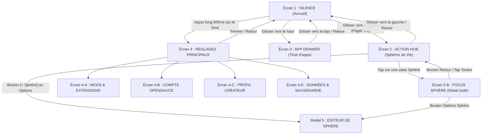

# OSauce — Spécification des Écrans, Navigation & Réglages

Guide de référence produit d'OpenSauce : navigation spatiale, description exhaustive de chaque écran, sous-écrans de réglages, modding et gestion du compte.

---

## 1. L'Elevator Pitch (Matrice des 6 Blocs)

| Bloc | Description | Contenu |
|---|---|---|
| **POUR ?** | *La cible visée* | Les personnes (étudiants, créatifs, jeunes actifs) qui veulent un téléphone qui redevient un outil utile et apaisant, sans couper les ponts avec le monde moderne. |
| **QUI ?** | *Le problème vécu* | En ont marre de passer 5h par jour sur leur smartphone sans s'en rendre compte, distraits par des flux mélangés et des interfaces conçues pour capter leur temps. |
| **NOTRE PRODUIT** | *La nature du projet* | **OpenSauce (OSauce)** est un launcher Android libre, éco-conçu et modulaire développé nativement en Kotlin et Jetpack Compose. |
| **QUI PERMET ?** | *Les capacités concrètes* | D'avoir un accueil calme avec l'heure en grand et 4 essentiels, de séparer sa vie en Sphères étanches (*Humains, Travail, Vital, Loisirs*), et de lancer n'importe quelle app au clavier en 2 secondes. |
| **CONTRAIREMENT** | *Aux alternatives* | Aux surcouches constructeurs lourdes et opaques, ou aux « dumbphones » rétrogrades qui bloquent les banques, le GPS et les billets de train. |
| **NOUS** | *Le différenciateur unique* | Proposons un système 100% transparent, fluide sur n'importe quel téléphone, avec un fond interactif sensoriel et une architecture ouverte aux mods de la communauté. |

---

## 2. Trame Vidéo de Présentation (5 Minutes — Ton Chill)

| Timing | Séquence | Ce qu'on montre & dit simplement |
|---|---|---|
| **0:00 - 1:00** | **Le Constat** | Montrer un téléphone encombré (tout est mélangé : messages persos, mails du travail, alertes inutiles). L'objectif d'OSauce : poser les choses, retrouver un téléphone calme, sans bloatware. |
| **1:00 - 2:00** | **Écran 1 : Silence** | Déverrouillage : grande horloge Space Grotesk, fond interactif discret qui réagit au doigt (*The Sauce*), 4 raccourcis essentiels. Fluide sur n'importe quel téléphone Android (récent ou ancien). |
| **2:00 - 3:15** | **Écran 2 : Action Hub & Sphères** | Glisser à droite. Présentation des Sphères réelles (*Humains, Travail, Vital, Loisirs*). Tap sur *Travail* : n'affiche que les outils pro et les tâches du domaine. Saisie rapide en bas et swipe sur les tâches (strikethrough progressif). |
| **3:15 - 4:00** | **Écran 3 : Tiroir d'apps** | Glisser vers le haut : recherche immédiate au clavier, liste claire et rail A-Z. Trouver une app en 2 secondes au lieu de chercher parmi 50 icônes. |
| **4:00 - 4:45** | **Écran 4 : Réglages, Mods & Compte** | Personnalisation du fond et des couleurs, gestionnaire de mods, espace de sauvegarde/export JSON, et compte créateur OpenSauce. |
| **4:45 - 5:00** | **Conclusion** | Projet gratuit, FOSS et disponible sur GitHub. |

---

## 3. Modèle Spatial Global de Navigation

---

## 4. Spécification Détaillée des Écrans Principaux

### Écran 1 : SILENCE (Accueil)
* **Rôle** : Accueil zen, zéro distraction.
* **Composants** :
  1. **Horloge Space Grotesk** : Chiffres géants (96sp). Clic dessus pour afficher ou masquer les secondes.
  2. **Jauge d'autonomie Canvas** : Trait vectoriel discret sous l'horloge indiquant le niveau de batterie sans chiffres anxiogènes.
  3. **Matrice « The Sauce »** : Fond dynamique réactif au toucher (vagues de couleur et traînée particulaire au glisser). Physique delta-time qui s'adapte automatiquement à l'écran du téléphone.
  4. **Phrase personnalisée** : Texte court sous l'horloge (ex: *"Un seul pas à la fois"*).
  5. **Dock 4 essentiels** : Raccourcis directs (Téléphone, Messages, Caméra, Applications) avec micro-scale tactile (0.94x).

---

### Écran 2 : ACTION HUB (Dashboard des Sphères)
* **Rôle** : Vue d'ensemble de ses domaines de vie et capture d'intentions.
* **Composants** :
  1. **En-tête** : Titre `ACTION HUB` + `Sphères & Intentions` avec bouton visible **`[ + Sphère ]`** en haut à droite.
  2. **Grille de Cartes de Sphères (`SphereCard` en 2 colonnes)** :
     - 4 sphères par défaut : **Humains** (`#4ADE80`), **Travail** (`#60A5FA`), **Vital** (`#FBBF24`), **Loisirs** (`#A78BFA`), plus les sphères personnalisées.
     - Chaque carte affiche :
       * Symbole géométrique vectoriel (1.5dp, sans emoji).
       * Nom de la sphère et halo de couleur.
       * Badge du nombre de tâches en attente (ex: `2 tâches`).
       * Mini-icônes des applications assignées (ex: Slack/Mail pour Travail).
       * Bouton d'édition sur la carte.
     - Carte **`[ + Créer une sphère ]`** en pointillé à la fin de la grille.
  3. **Barre de Capture Rapide** : Champ texte en bas avec bouton `+`. Taper Entrée enregistre immédiatement la tâche en SQLite local.
  4. **Tâches en cours** :
     - Clic case circulaire : rebond tactile et traçage progressif de la ligne barrée de gauche à droite.
     - Glisser vers la droite (Swipe right) : valide la tâche.
     - Glisser vers la gauche (Swipe left) : supprime la tâche.

---

### Écran 2-B : FOCUS SPHÈRE (Détail étanche)
* **Rôle** : Isoler un contexte mental pour travailler ou se détendre sans distraction externe.
* **Composants** :
  1. **Bandeau de navigation** : Bouton `← Toutes les sphères`, nom et couleur de la sphère, bouton paramètres.
  2. **Dock d'applications de la sphère** : Uniquement les applications affectées à cette sphère (ex: Slack, Gmail, Notion pour Travail). Lancement direct en 1 tap.
  3. **Capture ciblée** : Toute nouvelle tâche saisie ici est pré-assignée à cette sphère.
  4. **Tâches du domaine** : Liste filtrée exclusive des tâches en cours et terminées de ce domaine.

---

### Écran 3 : APP DRAWER (Tiroir d'applications)
* **Rôle** : Recherche intentionnelle rapide sans se perdre dans les icônes.
* **Composants** :
  1. **Champ de recherche** : Clavier ouvert automatiquement dès le swipe pour filtrer au texte.
  2. **Rail alphabétique A-Z** : Tranche tactile sur le bord droit pour sauter directement à une lettre.
  3. **Liste d'applications monochromes** : Icônes traitées en noir & blanc pour calmer les stimuli visuels.
  4. **Pastille de sphère** : Indicateur de couleur discret montrant le domaine de l'application.
  5. **Menu contextuel (Appui long)** : Assigner à une sphère, ouvrir les informations système, désinstaller.

---

## 5. Spécification Complète des Réglages & Sous-Écrans

### Écran 4 : RÉGLAGES PRINCIPAUX (Organisé en 8 Sections)

1. **Système & Lanceur** :
   - Définir comme lanceur par défaut Android (`ACTION_HOME_SETTINGS`).
   - Gestion des autorisations (Accès aux notifications pour le tri par sphère).
   - Langue de l'interface (Français / Anglais).
2. **Accueil & Silence** :
   - Affichage des secondes dynamiques (toggle).
   - Modification de la phrase de calme sous l'horloge.
   - Configuration des 4 applications du dock rapide (choix personnalisé).
3. **Moteur Sensoriel « The Sauce »** :
   - Moteur d'arrière-plan actif (The Sauce natif ou mod tiers).
   - Vibrance : *Subtile*, *Équilibrée*, *Éclatante*.
   - Forme des cellules : *Carrés arrondis*, *Cellules organiques*, *Croix matrice (+)*.
   - Densité : *Aéré (10x21)*, *Normal (15x32)*, *Dense (20x42)*.
   - Effets tactiles : Vagues au toucher, Traînée au glisser (*Drag Trail*).
4. **Apparence & Thèmes** :
   - Presets de thèmes OLED (*Dark*, *Phosphore*, *Cyberpunk*, *Mono*, *Violet*).
   - Bouton `[ Importer un thème JSON ]`.
5. **Sphères de Vie** :
   - Liste et réordonnancement des sphères.
   - Bouton de création directe.
   - Mods de comportement actifs (ex: planning horaire, focus strict).
6. **Tiroir d'applications** :
   - Toggle ouverture automatique du clavier au swipe.
   - Toggle filtre monochrome (Noir & Blanc vs Couleurs d'origine).
   - Gestion des applications masquées.
7. **Extensions, Compte & Sauvegarde** :
   - Accès à l'Écran 4-A (*Mods & Extensions*).
   - Accès à l'Écran 4-B / 4-C (*Compte OpenSauce*).
   - Accès à l'Écran 4-D (*Données & Sauvegarde*).
8. **À propos & Projet Libre** :
   - Version, code source GitHub, licence FOSS, crédits.

---

### Écran 4-A : MODS & EXTENSIONS (Gestionnaire & Découverte)
* **Onglet « Installés »** :
  - Liste de tous les mods présents (Thèmes, Moteurs d'arrière-plan, Comportements de sphères).
  - Interrupteur ON/OFF individuel pour activer ou désactiver un mod sans le désinstaller.
  - Bouton options / suppression.
* **Onglet « Découvrir »** :
  - Recherche et filtrage par catégorie (*Thèmes*, *Arrière-plans*, *Comportements*, *Outils*).
  - Classement par popularité / nouveauté.
* **Fiche Détail d'un Mod** :
  - Titre, auteur, numéro de version, description des fonctionnalités.
  - Aperçu visuel.
  - Liste des permissions requises (ex: accès au stockage local pour synchro Markdown).
  - Bouton Télécharger / Activer.

---

### Écran 4-B : COMPTE OPENSAUCE (Connexion / Inscription)
* **Rappel bienveillant** : *"Le mode invité local fonctionne à 100% sans compte. Créez un compte si vous souhaitez publier des mods ou sauvegarder vos favoris."*
* **Formulaire** :
  - Champs : Nom d'utilisateur, Email, Mot de passe.
  - Bascule rapide entre *Se connecter* et *Créer un compte*.
* **Authentification sécurisée** : Connexion par token JWT stocké de façon chiffrée sur le téléphone.

---

### Écran 4-C : PROFIL CRÉATEUR & SYNCHRONISATION
* **En-tête Profil** : Pseudo, email, badge rôle (`UTILISATEUR` ou `CRÉATEUR`).
* **Mes Créations Publiées** (Espace Créateur) :
  - Liste de mes mods en ligne avec compteur de téléchargements et note moyenne.
  - Bouton `[ Publier une nouvelle version ]`.
* **Mes Favoris Synchronisés** :
  - Liste des mods bookmarqués permettant de les réinstaller en un clic sur un autre appareil.
* **Bouton Déconnexion** (retour au mode invité local).

---

### Écran 4-D : DONNÉES & SAUVEGARDE (Import / Export)
* **Exporter les données** :
  - Génère un fichier de sauvegarde `.osauce` ou `.json` contenant : la liste de vos sphères, vos tâches en cours, vos réglages personnalisés et vos thèmes.
  - Sauvegarde locale sur le stockage du téléphone ou partage vers un autre appareil.
* **Importer une sauvegarde** :
  - Sélection d'un fichier de sauvegarde pour restaurer ses données en un instant.
* **Importer un style / mod externe** :
  - Champ de saisie pour coller directement le JSON d'un thème ou lien vers un mod.
* **Zone de purge** :
  - Bouton de réinitialisation complète des données locales (purge de la base SQLite).

---

### Modal 5 : ÉDITEUR / CRÉATEUR DE SPHÈRE (`EditSphereDialog`)
* **Rôle** : Créer ou modifier une sphère en quelques secondes.
* **Composants** :
  1. **Nom** : Champ texte (ex: *Finances, Famille, Studio*).
  2. **Palette 8 couleurs** : Teintes sobres accordées au design OSauce.
  3. **Symboles géométriques (8 icônes)** : Utilisateurs, Mallette, Onde vitale, Feuille, Étoile, Bouclier, Terminal, Boussole (zéro emoji).
  4. **Sélection des applications** : Liste des applications du téléphone avec cases à cocher pour définir les membres de la sphère.
  5. **Suppression** : Bouton supprimer actif pour les sphères personnalisées (protège les 4 sphères par défaut).
