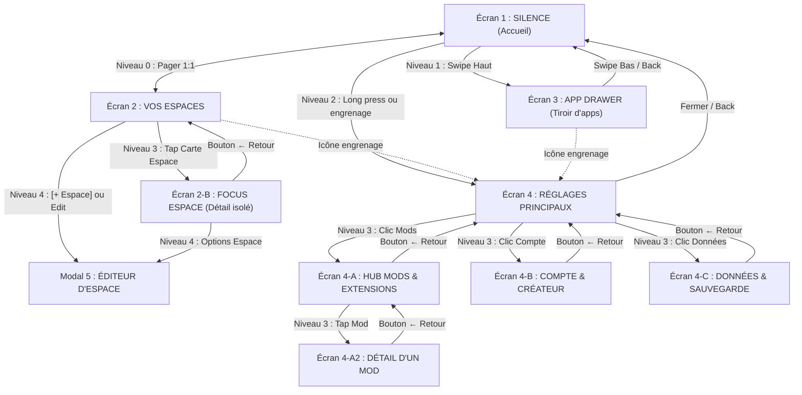

# OSauce — Spécification des Écrans, Navigation & Réglages

Guide de référence produit d'OpenSauce : matrice SSOT de navigation, description exhaustive de chaque écran, réglages hiérarchisés et sous-systèmes.

---

## 1. L'Elevator Pitch (Matrice des 6 Blocs)

| Bloc | Description | Contenu |
|---|---|---|
| **POUR ?** | *La cible visée* | Les personnes (étudiants, créatifs, jeunes actifs) qui veulent un téléphone qui redevient un outil utile et apaisant, sans couper les ponts avec le monde moderne. |
| **QUI ?** | *Le problème vécu* | En ont marre de passer 5h par jour sur leur smartphone sans s'en rendre compte, distraits par des flux mélangés et des interfaces conçues pour capter leur temps. |
| **NOTRE PRODUIT** | *La nature du projet* | **OpenSauce (OSauce)** est un launcher Android libre, éco-conçu et modulaire développé nativement en Kotlin et Jetpack Compose. |
| **QUI PERMET ?** | *Les capacités concrètes* | D'avoir un accueil calme avec l'heure en grand et 4 essentiels, de séparer sa vie en Espaces étanches (*Humains, Travail, Vital, Loisirs*), et de lancer n'importe quelle app au clavier en 2 secondes. |
| **CONTRAIREMENT** | *Aux alternatives* | Aux surcouches constructeurs lourdes et opaques, ou aux « dumbphones » rétrogrades qui bloquent les banques, le GPS et les billets de train. |
| **NOUS** | *Le différenciateur unique* | Proposons un système 100% transparent, fluide sur n'importe quel téléphone, avec un fond interactif sensoriel et une architecture ouverte aux mods de la communauté. |

---

## 2. Trame Vidéo de Présentation (5 Minutes — Ton Chill)

| Timing | Séquence | Ce qu'on montre & dit simplement |
|---|---|---|
| **0:00 - 1:00** | **Le Constat** | Montrer un téléphone encombré (tout est mélangé : messages persos, mails du travail, alertes inutiles). L'objectif d'OSauce : poser les choses, retrouver un téléphone calme, sans bloatware. |
| **1:00 - 2:00** | **Écran 1 : Silence** | Déverrouillage : grande horloge Space Grotesk, fond interactif discret qui réagit au doigt (*The Sauce*), 4 raccourcis essentiels. Fluide sur n'importe quel téléphone Android (récent ou ancien). |
| **2:00 - 3:15** | **Écran 2 : Vos Espaces** | Glisser à droite. Présentation des Espaces réels (*Humains, Travail, Vital, Loisirs*). Tap sur *Travail* : n'affiche que les outils pro et les tâches du domaine. Saisie rapide en bas et swipe sur les tâches (strikethrough progressif). |
| **3:15 - 4:00** | **Écran 3 : Tiroir d'apps** | Glisser vers le haut : recherche immédiate au clavier, liste claire et rail A-Z. Trouver une app en 2 secondes au lieu de chercher parmi 50 icônes. |
| **4:00 - 4:45** | **Écran 4 : Réglages, Mods & Compte** | Personnalisation du fond et des couleurs, gestionnaire de mods, espace de sauvegarde/export JSON, et compte créateur OpenSauce. |
| **4:45 - 5:00** | **Conclusion** | Projet gratuit, FOSS et disponible sur GitHub. |

---

## 3. Matrice SSOT des Transitions & Navigation Spatiale

Pour garantir une cohérence physique absolue (Apple Fluid Design & Emil Kowalski), chaque transition respecte une règle spatiale stricte :

| Niveau | Axe Spatial | Transition Entrée / Sortie | Geste Déclencheur | Écrans concernés |
|---|---|---|---|---|
| **Niveau 0 : Horizontal (Le Monde)** | Axe X continu (1:1) | `HorizontalPager` interruptible, friction `spring(damping = 0.85f)` | Glisser gauche $\leftrightarrow$ droite | `Silence` $\longleftrightarrow$ `Vos Espaces` |
| **Niveau 1 : Vertical (Les Tiroirs)** | Axe Y (Bas $\rightarrow$ Haut) | `slideInVertically` friction élastique + `scaleOut(0.96f)` du fond | Glisser vers le haut | `App Drawer` (Tiroir d'apps) |
| **Niveau 2 : Modale Principale** | Élévation ascendante | Fondu + expansion douce depuis le point de contact | Appui long 500ms sur le fond ou icône engrenage | `SettingsHome` (Menu Réglages) |
| **Niveau 3 : Drill-Down (Profondeur)** | Axe X Hiérarchique | **Push** : `slideInHorizontally(droite)` + `fadeIn` **Pop** : `slideOutHorizontally(droite)` + `fadeOut` | Tap sur carte ou item de menu | • `Vos Espaces` $\rightarrow$ `EspaceFocus` • `Settings` $\rightarrow$ `ModsHub` $\rightarrow$ `ModDetail` • `Settings` $\rightarrow$ `AuthProfile` • `Settings` $\rightarrow$ `DataBackup` |
| **Niveau 4 : Dialogues Contextuels** | Pop-up centré | Fond assombri (`alpha 0.5f`) + scale élastique (0.95x $\rightarrow$ 1.0x) | Tap sur bouton action | `EditEspaceDialog`, Menu contextuel app |

---

## 4. Arbre Fonctionnel Exhaustif (Décomposition Produit)

### 4.1 Vue Graphique Hiérarchique (Orientation Naturelle Gauche $\rightarrow$ Droite)

---

### 4.2 Arborescence Textuelle Détaillée (Lecture Directe Sans Zoom)

* **1. Écran SILENCE (Accueil Zen · Niveau 0 Pager)**
  * **1.1. Horloge Monument Space Grotesk** : Chiffres 96sp avec tap interactif pour afficher/masquer les secondes animées.
  * **1.2. Jauge d'autonomie Canvas** : Trait vectoriel discret sous l'horloge proportionnel à la batterie (sans chiffres anxiogènes).
  * **1.3. Devise de calme personnalisable** : Phrase inspirante courte (édition par dialogue modal Niveau 4).
  * **1.4. Moteur d'arrière-plan interactif « The Sauce » (@OpenSauce)** : Grille 15x32 (480 cellules), delta-time 120Hz, rovers ambiants, gerbes tactiles et traînée fluide au glisser (*Drag Trail*).
  * **1.5. Dock des 4 essentiels** : Raccourcis directs (Téléphone, Messages, Caméra, Tiroir) avec micro-scale tactile 0.94x sans ripple Material.
  * **1.6. Accès universel aux Paramètres** : Via appui long 500ms sur le fond ou icône engrenage dans l'en-tête.

* **2. Écran VOS ESPACES (Gestionnaire de Domaines & Intentions · Niveau 0 Pager)**
  * **2.1. En-tête de contrôle** : Titre `Vos Espaces` + bouton visible **`[ + Espace ]`** + raccourci vers les Paramètres.
  * **2.2. Grille 2 colonnes de cartes d'espace modulaires** :
    * 4 Espaces natifs : **Humains** (`#4ADE80`), **Travail** (`#60A5FA`), **Vital** (`#FBBF24`), **Loisirs** (`#A78BFA`).
    * Contenu de chaque carte : symbole géométrique vectoriel 1.5dp, nom du domaine, halo de couleur d'accent, badge compteur de tâches, mini-icônes des applications assignées, flèche d'accès direct.
    * Bouton pointillé **`[ + Créer une sphère ]`** (ou `+ Créer un espace`) sous la grille.
  * **2.3. Modal d'édition/création `EditEspaceDialog` (Niveau 4)** : Nom, sélection dans la palette de 8 couleurs OSauce, sélection parmi 8 icônes vectorielles (zéro emoji), liste des applications installées avec cases à cocher et recherche, suppression d'espace.
  * **2.4. Section « À votre rythme » & Barre de capture rapide SQLite** : Intentions avec jauge de progression (ex: 60%), compteur de progression (ex: 3 / 8), champ de saisie 1-tap en bas d'écran avec touche Entrée clavier.
  * **2.5. Moteur d'intentions à gestes tactiles** :
    * Case à cocher circulaire avec rebond ressort (*spring*).
    * Jauge de complétion et strikethrough dynamique.
    * Gestes de swipe tactile `SwipeToDismissBox` : glisser vers la droite pour terminer (rebond fluide avec tick vert), glisser vers la gauche pour supprimer.

* **2-B. Sous-Écran FOCUS ESPACE / DÉTAIL DE L'ESPACE (Détail Étanche · Niveau 3 Drill-Down)**
  * **2-B.1. Bandeau de focus** : Bouton retour `← Tout les espaces`, nom de l'espace en grand titre (ex: `Travail`), pastille de couleur, icône stylo d'édition.
  * **2-B.2. Dock étanche d'applications** : Uniquement les applications assignées à ce domaine (ex: Slack, Gmail, Notion, Drive pour Travail).
  * **2-B.3. Liste exclusive du domaine** : Onglets `En cours · X` et `Terminé`, dates/heures d'échéance, badges d'apps liées (ex: Slack, Notion).
  * **2-B.4. Capture contextuelle** : Toute tâche ou intention saisie ici est automatiquement pré-assignée à cet espace.

* **3. Écran APP DRAWER (Tiroir d'Applications · Niveau 1 Swipe Haut)**
  * **3.1. Recherche instantanée texte** : Clavier ouvert automatiquement dès le swipe pour filtrage temps réel.
  * **3.2. Rail alphabétique tactile vertical A-Z (`AlphabetScroller`)** : Tranche tactile sur le bord droit avec saut instantané dans le `LazyListState`.
  * **3.3. Rendu monochrome GPU** : Icônes traitées en noir & blanc via `ColorMatrix` pour neutraliser les stimuli dopaminergiques.
  * **3.4. Pastille discrète d'espace** : Indicateur de couleur montrant le domaine auquel chaque application appartient.
  * **3.5. Menu contextuel d'application par appui long (Niveau 4)** : Assigner/réassigner à un espace, ouvrir les informations système Android, désinstaller l'application.
  * **3.6. Raccourci Paramètres** : Icône engrenage en en-tête pour accès direct sans repasser par l'accueil.

* **4. Écran PARAMÈTRES (Hub en 8 Lignes · Niveau 2 Modal)**
  * **4.1. Définir comme Launcher** : Toggle direct activé/désactivé avec appel système Android (`ACTION_HOME_SETTINGS`).
  * **4.2. Page d'accueil** : Secondes actives, devise de calme, raccourcis d'apps du dock rapide.
  * **4.3. Moteur The Sauce (@OpenSauce)** : Vibrance (Subtile / Équilibrée / Éclatante), morphologie des cellules (Carrés doux / Organique / Croix), toggle du dessin de traînée (*Drag Trail : ON/OFF*).
  * **4.4. Apparence et thèmes** : Thème Sombre / Noir OLED pur, prévisualisation directe de la palette de couleurs, importation de thèmes JSON.
  * **4.5. Vos Espaces** : Statut (ex: 4 actives), réordonnancement par glisser-déposer, création directe.
  * **4.6. Tiroir d'applications** : Filtre monochrome activé/désactivé, auto-focus clavier à l'ouverture, applications masquées.
  * **4.7. Extensions, compte et sauvegarde** : Aiguillage vers les sous-écrans Mods (@OpenSauce et communautaires), Compte utilisateur et Sauvegarde de données.
  * **4.8. À propos et projet libre** : Numéro de version (v1.0.0), lien GitHub officiel, licence Apache-2.0.

* **4-A. Sous-Écran HUB D'EXTENSIONS & MODS (Niveau 3 Drill-Down)**
  * **4-A.1. Onglet « Mes Mods »** : Listing des extensions installées avec interrupteurs ON/OFF à chaud (sans redémarrage), incluant le mod natif *The Sauce* par `@OpenSauce`.
  * **4-A.2. Onglet « Explorer »** : Catalogue communautaire et officiel (@OpenSauce) avec filtres par catégorie (Thèmes, Arrière-plans, Comportements, Outils).
  * **4-A.3. Fiche détaillée de mod (Niveau 3-A2)** : Aperçu, auteur (`@OpenSauce` ou créateur tiers), version, description, permissions requises, bouton Installer/Désinstaller.

* **4-B. Sous-Écran COMPTE OPENSAUCE & CRÉATEUR (Niveau 3 Drill-Down)**
  * **4-B.1. Authentification JWT optionnelle** : Connexion / Inscription avec rappel explicite du mode invité 100% hors-ligne sans compte.
  * **4-B.2. Profil créateur** : Gestion et publication de ses propres extensions, suivi des statistiques.
  * **4-B.3. Synchronisation cloud chiffrée** : Sauvegarde des favoris et thèmes entre plusieurs appareils.

* **4-C. Sous-Écran DONNÉES & SAUVEGARDE (Niveau 3 Drill-Down)**
  * **4-C.1. Exportation JSON claire** : Sauvegarde complète de la base SQLite (espaces, intentions/tâches, réglages) en fichier JSON lisible.
  * **4-C.2. Importation SAF Android** : Restauration d'une sauvegarde ou d'un thème avec validation stricte du schéma JSON.
  * **4-C.3. Purge locale sécurisée** : Dialogue modal de réinitialisation complète des données avec confirmation explicite.

---

## 5. Spécification Détaillée des Écrans

### Écran 1 : SILENCE (Accueil)
* **Rôle** : Accueil zen, zéro distraction.
* **Composants** :
  1. **Horloge Space Grotesk** : Chiffres géants (96sp). Clic dessus pour afficher ou masquer les secondes.
  2. **Jauge d'autonomie Canvas** : Trait vectoriel discret sous l'horloge montrant le niveau de batterie sans chiffres anxiogènes.
  3. **Moteur « The Sauce » (@OpenSauce)** : Fond dynamique réactif au toucher (vagues de couleur et traînée particulaire au glisser). Physique delta-time qui s'adapte automatiquement à l'écran du téléphone.
  4. **Phrase personnalisée** : Texte court sous l'horloge (ex: *"Un seul pas à la fois"*).
  5. **Dock 4 essentiels** : Raccourcis directs (Téléphone, Messages, Caméra, Applications) avec micro-scale tactile (0.94x).

---

### Écran 2 : VOS ESPACES (Gestionnaire de Domaines & Intentions)
* **Rôle** : Vue d'ensemble de ses domaines de vie et capture d'intentions.
* **Composants** :
  1. **En-tête** : Titre `Vos Espaces` + bouton visible **`+ Espace`** et icône engrenage d'accès direct aux Paramètres.
  2. **Grille de Cartes d'Espace (2 colonnes)** :
     - 4 espaces par défaut : **Humains** (`#4ADE80`), **Travail** (`#60A5FA`), **Vital** (`#FBBF24`), **Loisirs** (`#A78BFA`), plus les espaces personnalisés.
     - Chaque carte affiche : symbole géométrique vectoriel, nom, flèche diagonale d'accès, badge compteur d'intentions, mini-icônes des applications assignées.
     - Tap sur la carte : transition Niveau 3 (Drill-Down) vers l'écran **Focus Espace** (`Travail`, etc.).
     - Bouton pointillé **`+ Créer une sphère`** (ou `+ Créer un espace`) sous la grille.
  3. **Section « À votre rythme » & Barre de Capture Rapide** : Compteur d'intentions (ex: 3 / 8), intentions avec jauge de progression, champ texte en bas avec bouton `+`. Taper Entrée enregistre immédiatement en SQLite local.
  4. **Intentions et gestes tactiles** :
     - Clic case circulaire : rebond tactile et traçage progressif de la ligne barrée.
     - Glisser vers la droite (Swipe right) : valide l'intention (coche verte fluide).
     - Glisser vers la gauche (Swipe left) : supprime l'intention.

---

### Écran 2-B : FOCUS ESPACE (Détail étanche en Drill-Down)
* **Rôle** : Isoler un contexte mental pour travailler ou se détendre sans distraction externe.
* **Composants** :
  1. **Bandeau de navigation** : Bouton `← Tout les espaces`, pastille colorée `• Espace`, grand titre (ex: `Travail`), icône crayon d'édition.
  2. **Dock d'applications de l'espace** : Uniquement les applications affectées à cet espace (ex: Slack, Gmail, Notion, Drive pour Travail). Lancement direct en 1 tap.
  3. **Onglets et Intentions** : Onglets `En cours · 5` et `Terminé`, échéances datées (`Aujourd'hui · 16:00`), badges contextuels d'applications reliées (`Notion`, `Slack`).
  4. **Capture ciblée** : Toute nouvelle intention saisie ici est automatiquement pré-assignée à cet espace.

---

### Écran 3 : APP DRAWER (Tiroir d'applications)
* **Rôle** : Recherche intentionnelle rapide sans se perdre dans les icônes.
* **Composants** :
  1. **Champ de recherche** : Clavier ouvert automatiquement dès le swipe pour filtrer au texte.
  2. **Rail alphabétique A-Z** : Tranche tactile sur le bord droit pour sauter directement à une lettre d'un glissement de pouce.
  3. **Liste d'applications monochromes** : Icônes traitées en noir & blanc pour calmer les stimuli visuels.
  4. **Pastille d'espace** : Indicateur de couleur discret montrant le domaine auquel l'application appartient.
  5. **Menu contextuel (Appui long Niveau 4)** : Assigner à un espace, ouvrir les informations système, désinstaller.
  6. **Icône engrenage en en-tête** : Accès direct aux Paramètres sans repasser par le Silence Screen.

---

### Écran 4 : PARAMÈTRES (Hub en 8 Lignes)
* **Rôle** : Hub d'aiguillage vers les réglages et les sous-écrans dédiés.
* **Composants en 8 lignes claires** :
  1. **Définir comme Launcher** : Toggle ON/OFF direct avec appel système (`ACTION_HOME_SETTINGS`).
  2. **Page d'accueil** : Secondes actives, devise de calme, raccourcis d'apps du dock rapide.
  3. **Moteur The Sauce (@OpenSauce)** : Vibrance (Équilibrée), morphologie des cellules (Carrés doux), Drag Trail : ON/OFF.
  4. **Apparence et thèmes** : Thème Sombre / Noir OLED, palette de prévisualisation des couleurs.
  5. **Vos Espaces** : Compteur d'espaces actifs (ex: 4 actives), option réordonner.
  6. **Tiroir d'applications** : Filtre monochrome : Activé, Clavier auto-focus.
  7. **Extensions, compte et sauvegarde** : Accès centralisé aux 3 modules avancés (Mods, Compte, Sauvegarde).
  8. **À propos et projet libre** : Version (v1.0.0), lien GitHub, Licence Apache-2.0.

---

### Sous-Écrans Dédiés des Paramètres (Drill-Down Niveau 3)

#### Écran 4-A : HUB MODS & EXTENSIONS (Plein Écran)
* **Bandeau supérieur** : Bouton `← Paramètres` + Barre de recherche de mods.
* **Onglet « Mes Mods »** :
  - Liste de tous les mods installés (*The Sauce* par `@OpenSauce`, thèmes, hooks d'espaces).
  - Interrupteur ON/OFF individuel pour activer ou désactiver sans supprimer.
  - Bouton options / suppression.
* **Onglet « Explorer »** :
  - Catalogue officiel (@OpenSauce) et communautaire avec filtres (*Thèmes*, *Arrière-plans*, *Comportements*, *Outils*).
  - Cartes avec titre, auteur, version et note.
  - Clic sur une carte $\rightarrow$ Ouvre l'Écran 4-A2 (*Fiche Détail d'un Mod*).

#### Écran 4-A2 : FICHE DÉTAIL D'UN MOD
* Aperçu visuel plein format, auteur (`@OpenSauce` ou tiers), numéro de version, description des fonctionnalités.
* Liste des permissions requises (ex: accès au stockage local pour synchro Markdown).
* Bouton Installer / Activer.

#### Écran 4-B : COMPTE OPENSAUCE & ESPACE CRÉATEUR
* **Bandeau supérieur** : Bouton `← Paramètres`.
* **État Invité (Déconnecté)** :
  - Rappel : le mode local fonctionne à 100% sans compte.
  - Formulaire de connexion / inscription (Pseudo, Email, Mot de passe).
* **État Connecté (Profil & Créateur)** :
  - Pseudo, email, badge rôle (`UTILISATEUR` ou `CRÉATEUR`).
  - *Espace Créateur* : gestion des mods publiés, stats de téléchargements, bouton pour publier une nouvelle version.
  - *Favoris synchronisés* : liste des mods bookmarqués réinstallables en un clic.
  - Bouton Déconnexion.

#### Écran 4-C : GESTION DES DONNÉES & SAUVEGARDE
* **Bandeau supérieur** : Bouton `← Paramètres`.
* **Exporter** : Génère un fichier de sauvegarde `.osauce` ou `.json` (espaces, intentions, réglages, thèmes personnalisés).
* **Importer une sauvegarde** : Restaure l'état complet du lanceur depuis un fichier local.
* **Importer un style / mod externe** : Zone de saisie pour coller directement le JSON d'un thème ou d'un mod.
* **Zone de purge** : Réinitialisation complète de la base SQLite locale.

---

### Modal 5 : ÉDITEUR / CRÉATEUR D'ESPACE (`EditEspaceDialog` — Niveau 4)
* **Composants** :
  1. **Nom** : Champ texte (ex: *Finances, Famille, Studio*).
  2. **Palette 8 couleurs** : Teintes sobres accordées au design OSauce.
  3. **Symboles géométriques (8 icônes)** : Utilisateurs, Boîte 3D, Onde vitale, Manette de jeu, Feuille, Étoile, Bouclier, Terminal (zéro emoji).
  4. **Sélection des applications** : Liste des applications du téléphone avec cases à cocher pour définir les membres de l'espace.
  5. **Suppression** : Bouton supprimer actif pour les espaces personnalisés (protège les 4 espaces par défaut).
