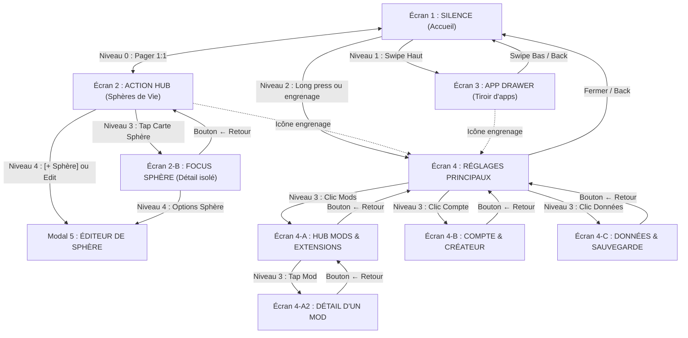
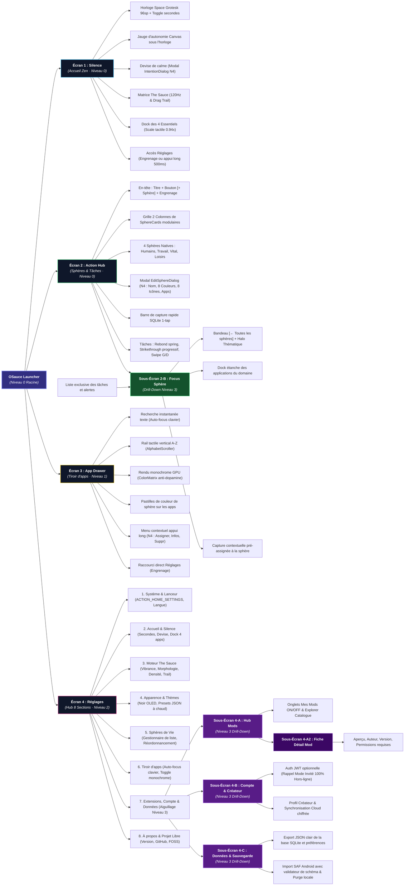

# OSauce — Spécification des Écrans, Navigation & Réglages

Guide de référence produit d'OpenSauce : matrice SSOT de navigation, description exhaustive de chaque écran, réglages hiérarchisés et sous-systèmes.

---

## 1. L'Elevator Pitch (Matrice des 6 Blocs)

| Bloc | Description | Contenu |
|---|---|---|
| **POUR ?** | *La cible visée* | Les personnes (étudiants, créatifs, jeunes actifs) qui veulent un téléphone qui redevient un outil utile et apaisant, sans couper les ponts avec le monde moderne. |
| **QUI ?** | *Le problème vécu* | En ont marre de passer 5h par jour sur leur smartphone sans s'en rendre compte, distraits par des flux mélangés et des interfaces conçues pour capter leur temps. |
| **NOTRE PRODUIT** | *La nature du projet* | **OpenSauce (OSauce)** est un launcher Android libre, éco-conçu et modulaire développé nativement en Kotlin et Jetpack Compose. |
| **QUI PERMET ?** | *Les capacités concrètes* | D'avoir un accueil calme avec l'heure en grand et 4 essentiels, de séparer sa vie en Sphères étanches (*Humains, Travail, Vital, Loisirs*), et de lancer n'importe quelle app au clavier en 2 secondes. |
| **CONTRAIREMENT** | *Aux alternatives* | Aux surcouches constructeurs lourdes et opaques, ou aux « dumbphones » rétrogrades qui bloquent les banques, le GPS et les billets de train. |
| **NOUS** | *Le différenciateur unique* | Proposons un système 100% transparent, fluide sur n'importe quel téléphone, avec un fond interactif sensoriel et une architecture ouverte aux mods de la communauté. |

---

## 2. Trame Vidéo de Présentation (5 Minutes — Ton Chill)

| Timing | Séquence | Ce qu'on montre & dit simplement |
|---|---|---|
| **0:00 - 1:00** | **Le Constat** | Montrer un téléphone encombré (tout est mélangé : messages persos, mails du travail, alertes inutiles). L'objectif d'OSauce : poser les choses, retrouver un téléphone calme, sans bloatware. |
| **1:00 - 2:00** | **Écran 1 : Silence** | Déverrouillage : grande horloge Space Grotesk, fond interactif discret qui réagit au doigt (*The Sauce*), 4 raccourcis essentiels. Fluide sur n'importe quel téléphone Android (récent ou ancien). |
| **2:00 - 3:15** | **Écran 2 : Action Hub & Sphères** | Glisser à droite. Présentation des Sphères réelles (*Humains, Travail, Vital, Loisirs*). Tap sur *Travail* : n'affiche que les outils pro et les tâches du domaine. Saisie rapide en bas et swipe sur les tâches (strikethrough progressif). |
| **3:15 - 4:00** | **Écran 3 : Tiroir d'apps** | Glisser vers le haut : recherche immédiate au clavier, liste claire et rail A-Z. Trouver une app en 2 secondes au lieu de chercher parmi 50 icônes. |
| **4:00 - 4:45** | **Écran 4 : Réglages, Mods & Compte** | Personnalisation du fond et des couleurs, gestionnaire de mods, espace de sauvegarde/export JSON, et compte créateur OpenSauce. |
| **4:45 - 5:00** | **Conclusion** | Projet gratuit, FOSS et disponible sur GitHub. |

---

## 3. Matrice SSOT des Transitions & Navigation Spatiale

Pour garantir une cohérence physique absolue (Apple Fluid Design & Emil Kowalski), chaque transition respecte une règle spatiale stricte :

| Niveau | Axe Spatial | Transition Entrée / Sortie | Geste Déclencheur | Écrans concernés |
|---|---|---|---|---|
| **Niveau 0 : Horizontal (Le Monde)** | Axe X continu (1:1) | `HorizontalPager` interruptible, friction `spring(damping = 0.85f)` | Glisser gauche $\leftrightarrow$ droite | `Silence` $\longleftrightarrow$ `Action Hub` |
| **Niveau 1 : Vertical (Les Tiroirs)** | Axe Y (Bas $\rightarrow$ Haut) | `slideInVertically` friction élastique + `scaleOut(0.96f)` du fond | Glisser vers le haut | `App Drawer` (Tiroir d'apps) |
| **Niveau 2 : Modale Principale** | Élévation ascendante | Fondu + expansion douce depuis le point de contact | Appui long 500ms sur le fond ou icône engrenage | `SettingsHome` (Menu Réglages) |
| **Niveau 3 : Drill-Down (Profondeur)** | Axe X Hiérarchique | **Push** : `slideInHorizontally(droite)` + `fadeIn`<br>**Pop** : `slideOutHorizontally(droite)` + `fadeOut` | Tap sur carte ou item de menu | • `Action Hub` $\rightarrow$ `SphereFocus`<br>• `Settings` $\rightarrow$ `ModsHub` $\rightarrow$ `ModDetail`<br>• `Settings` $\rightarrow$ `AuthProfile`<br>• `Settings` $\rightarrow$ `DataBackup` |
| **Niveau 4 : Dialogues Contextuels** | Pop-up centré | Fond assombri (`alpha 0.5f`) + scale élastique (0.95x $\rightarrow$ 1.0x) | Tap sur bouton action | `EditSphereDialog`, Menu contextuel app |



---

## 4. Arbre Fonctionnel Exhaustif (Décomposition Produit)

### 4.1 Vue Graphique Hiérarchique (Orientation Naturelle Gauche $\rightarrow$ Droite)



    Root --> Col1
    Root --> Col2
    Root --> Col3
```

---

### 4.2 Arborescence Textuelle Détaillée (Lecture Directe Sans Zoom)

* **1. Écran SILENCE (Accueil Zen · Niveau 0 Pager)**
  * **1.1. Horloge Monument Space Grotesk** : Chiffres 96sp avec tap interactif pour afficher/masquer les secondes animées.
  * **1.2. Jauge d'autonomie Canvas** : Trait vectoriel discret sous l'horloge proportionnel à la batterie (sans chiffres anxiogènes).
  * **1.3. Devise de calme personnalisable** : Phrase inspirante courte (édition par dialogue modal Niveau 4).
  * **1.4. Matrice interactive « The Sauce »** : Grille 15x32 (480 cellules), delta-time 120Hz, rovers ambiants, gerbes tactiles et traînée fluide au glisser (*Drag Trail*).
  * **1.5. Dock des 4 essentiels** : Raccourcis directs (Téléphone, Messages, Caméra, Tiroir) avec micro-scale tactile 0.94x sans ripple Material.
  * **1.6. Accès universel aux Réglages** : Via appui long 500ms sur le fond ou icône engrenage dans l'en-tête.

* **2. Écran ACTION HUB (Dashboard des Sphères · Niveau 0 Pager)**
  * **2.1. En-tête de contrôle** : Titre `ACTION HUB` + bouton visible **`[ + Sphère ]`** + raccourci vers les Réglages.
  * **2.2. Grille 2 colonnes de cartes modulaires (`SphereCard`)** :
    * 4 Sphères natives : **Humains** (`#4ADE80`), **Travail** (`#60A5FA`), **Vital** (`#FBBF24`), **Loisirs** (`#A78BFA`).
    * Contenu de chaque carte : symbole géométrique vectoriel 1.5dp, nom du domaine, halo de couleur d'accent, badge compteur de tâches, mini-icônes des applications assignées, bouton d'édition rapide.
    * Carte pointillée **`[ + Créer une sphère ]`** en fin de grille.
  * **2.3. Modal d'édition/création `EditSphereDialog` (Niveau 4)** : Nom, sélection dans la palette de 8 couleurs OSauce, sélection parmi 8 icônes vectorielles (zéro emoji), liste des applications installées avec cases à cocher et recherche, suppression de sphère.
  * **2.4. Barre de capture rapide SQLite** : Champ de saisie 1-tap en bas d'écran avec touche Entrée clavier.
  * **2.5. Moteur de tâches à gestes tactiles** :
    * Case à cocher circulaire avec rebond ressort (*spring*).
    * Traçage vectoriel dynamique et progressif du strikethrough (de 0% à 100%).
    * Gestes de swipe tactile `SwipeToDismissBox` : glisser vers la droite pour terminer (rebond fluide), glisser vers la gauche pour supprimer.

* **2-B. Sous-Écran FOCUS SPHÈRE (Détail Étanche · Niveau 3 Drill-Down)**
  * **2-B.1. Bandeau de focus** : Bouton retour `← Toutes les sphères`, nom et halo thématique de la sphère active.
  * **2-B.2. Dock étanche d'applications** : Uniquement les applications assignées à ce domaine (ex: Slack et Gmail pour Travail).
  * **2-B.3. Liste exclusive du domaine** : Affichage filtré des tâches et alertes rattachées à la sphère.
  * **2-B.4. Capture contextuelle** : Toute tâche saisie ici est automatiquement pré-assignée à cette sphère.

* **3. Écran APP DRAWER (Tiroir d'Applications · Niveau 1 Swipe Haut)**
  * **3.1. Recherche instantanée texte** : Clavier ouvert automatiquement dès le swipe pour filtrage temps réel.
  * **3.2. Rail alphabétique tactile vertical A-Z (`AlphabetScroller`)** : Tranche tactile sur le bord droit avec saut instantané dans le `LazyListState`.
  * **3.3. Rendu monochrome GPU** : Icônes traitées en noir & blanc via `ColorMatrix` pour neutraliser les stimuli dopaminergiques.
  * **3.4. Pastille discrète de sphère** : Indicateur de couleur montrant le domaine auquel chaque application appartient.
  * **3.5. Menu contextuel d'application par appui long (Niveau 4)** : Assigner/réassigner à une sphère, ouvrir les informations système Android, désinstaller l'application.
  * **3.6. Raccourci Réglages** : Icône engrenage en en-tête pour accès direct sans repasser par l'accueil.

* **4. Écran RÉGLAGES PRINCIPAUX (Hub en 8 Sections · Niveau 2 Modal)**
  * **4.1. Système & Lanceur** : Définir comme lanceur par défaut Android direct (`ACTION_HOME_SETTINGS`), autorisations système, bilinguisme FR/EN.
  * **4.2. Accueil & Silence** : Secondes dynamiques de l'horloge, devise de calme personnalisable, configuration des 4 apps du dock.
  * **4.3. Moteur Sensoriel « The Sauce »** : Vibrance (Subtile / Équilibrée / Éclatante), morphologie des cellules (Carré / Organique / Croix), densité de grille (Large / Normal / Dense / Micro), toggle du dessin de traînée (*Drag Drawing Trail*).
  * **4.4. Apparence & Thèmes** : Presets Noir OLED pur, prévisualisation et injection dynamique des couleurs, importation de thèmes JSON.
  * **4.5. Sphères de Vie** : Liste et réordonnancement des sphères, bouton de création directe.
  * **4.6. Tiroir d'applications** : Auto-focus clavier, toggle du filtre monochrome, gestion des applications masquées.
  * **4.7. Extensions, Compte & Données** : Aiguillage Niveau 3 vers les 3 sous-écrans spécialisés.
  * **4.8. À propos & Projet Libre** : Version, auteur, dépôt GitHub public, licence libre FOSS.

* **4-A. Sous-Écran HUB D'EXTENSIONS & MODS (Niveau 3 Drill-Down)**
  * **4-A.1. Onglet « Mes Mods »** : Listing des extensions installées avec interrupteurs ON/OFF à chaud (sans redémarrage).
  * **4-A.2. Onglet « Explorer »** : Catalogue communautaire avec filtres par catégorie (Thèmes, Arrière-plans, Comportements, Outils).
  * **4-A.3. Fiche détaillée de mod (Niveau 3-A2)** : Aperçu, auteur, version, description, permissions requises, bouton Installer/Désinstaller.

* **4-B. Sous-Écran COMPTE OPENSAUCE & CRÉATEUR (Niveau 3 Drill-Down)**
  * **4-B.1. Authentification JWT optionnelle** : Connexion / Inscription avec rappel explicite du mode invité 100% hors-ligne sans compte.
  * **4-B.2. Profil créateur** : Gestion et publication de ses propres extensions, suivi des statistiques.
  * **4-B.3. Synchronisation cloud chiffrée** : Sauvegarde des favoris et thèmes entre plusieurs appareils.

* **4-C. Sous-Écran DONNÉES & SAUVEGARDE (Niveau 3 Drill-Down)**
  * **4-C.1. Exportation JSON claire** : Sauvegarde complète de la base SQLite (sphères, tâches, réglages) en fichier JSON lisible.
  * **4-C.2. Importation SAF Android** : Restauration d'une sauvegarde ou d'un thème avec validation stricte du schéma JSON.
  * **4-C.3. Purge locale sécurisée** : Dialogue modal de réinitialisation complète des données avec confirmation explicite.

---

## 5. Spécification Détaillée des Écrans

### Écran 1 : SILENCE (Accueil)
* **Rôle** : Accueil zen, zéro distraction.
* **Composants** :
  1. **Horloge Space Grotesk** : Chiffres géants (96sp). Clic dessus pour afficher ou masquer les secondes.
  2. **Jauge d'autonomie Canvas** : Trait vectoriel discret sous l'horloge montrant le niveau de batterie sans chiffres anxiogènes.
  3. **Matrice « The Sauce »** : Fond dynamique réactif au toucher (vagues de couleur et traînée particulaire au glisser). Physique delta-time qui s'adapte automatiquement à l'écran du téléphone.
  4. **Phrase personnalisée** : Texte court sous l'horloge (ex: *"Un seul pas à la fois"*).
  5. **Dock 4 essentiels** : Raccourcis directs (Téléphone, Messages, Caméra, Applications) avec micro-scale tactile (0.94x).

---

### Écran 2 : ACTION HUB (Dashboard des Sphères)
* **Rôle** : Vue d'ensemble de ses domaines de vie et capture d'intentions.
* **Composants** :
  1. **En-tête** : Titre `ACTION HUB` + bouton visible **`[ + Sphère ]`** et icône engrenage d'accès direct aux réglages.
  2. **Grille de Cartes de Sphères (`SphereCard` en 2 colonnes)** :
     - 4 sphères par défaut : **Humains** (`#4ADE80`), **Travail** (`#60A5FA`), **Vital** (`#FBBF24`), **Loisirs** (`#A78BFA`), plus les sphères personnalisées.
     - Chaque carte affiche : symbole géométrique vectoriel, nom, halo de couleur, badge du nombre de tâches en attente, mini-icônes des applications assignées, bouton d'édition.
     - Tap sur la carte : transition Niveau 3 (Drill-Down) vers l'écran **Focus Sphère**.
     - Carte **`[ + Créer une sphère ]`** en pointillé à la fin de la grille.
  3. **Barre de Capture Rapide** : Champ texte en bas avec bouton `+`. Taper Entrée enregistre immédiatement la tâche en SQLite local.
  4. **Tâches en cours** :
     - Clic case circulaire : rebond tactile et traçage progressif de la ligne barrée.
     - Glisser vers la droite (Swipe right) : valide la tâche.
     - Glisser vers la gauche (Swipe left) : supprime la tâche.

---

### Écran 2-B : FOCUS SPHÈRE (Détail étanche en Drill-Down)
* **Rôle** : Isoler un contexte mental pour travailler ou se détendre sans distraction externe.
* **Composants** :
  1. **Bandeau de navigation** : Bouton `← Toutes les sphères`, nom et couleur de la sphère active, bouton paramètres.
  2. **Dock d'applications de la sphère** : Uniquement les applications affectées à cette sphère (ex: Slack, Gmail, Notion pour Travail). Lancement direct en 1 tap.
  3. **Capture ciblée** : Toute nouvelle tâche saisie ici est pré-assignée à cette sphère.
  4. **Tâches du domaine** : Liste filtrée exclusive des tâches en cours et terminées de ce domaine.

---

### Écran 3 : APP DRAWER (Tiroir d'applications)
* **Rôle** : Recherche intentionnelle rapide sans se perdre dans les icônes.
* **Composants** :
  1. **Champ de recherche** : Clavier ouvert automatiquement dès le swipe pour filtrer au texte.
  2. **Rail alphabétique A-Z** : Tranche tactile sur le bord droit pour sauter directement à une lettre d'un glissement de pouce.
  3. **Liste d'applications monochromes** : Icônes traitées en noir & blanc pour calmer les stimuli visuels.
  4. **Pastille de sphère** : Indicateur de couleur discret montrant le domaine auquel l'application appartient.
  5. **Menu contextuel (Appui long Niveau 4)** : Assigner à une sphère, ouvrir les informations système, désinstaller.
  6. **Icône engrenage en en-tête** : Accès direct aux Réglages sans repasser par le Silence Screen.

---

### Écran 4 : RÉGLAGES PRINCIPAUX (Hub en 8 Sections)
* **Rôle** : Hub d'aiguillage vers les réglages et les sous-écrans dédiés.
* **Sections directes** :
  1. **Système & Lanceur** : Définir comme lanceur par défaut Android (`ACTION_HOME_SETTINGS`), autorisations Android, langue.
  2. **Accueil & Silence** : Secondes de l'horloge, phrase de calme, choix des 4 applications du dock rapide.
  3. **Moteur Sensoriel « The Sauce »** : Moteur d'arrière-plan actif, vibrance, forme des cellules, densité, toggles particules et traînée (*Drag Trail*).
  4. **Apparence & Thèmes** : Presets OLED, importation de thèmes JSON.
  5. **Sphères de Vie** : Liste et réordonnancement, bouton de création directe.
  6. **Tiroir d'applications** : Clavier auto-focus, filtre monochrome, applications masquées.
  7. **Extensions, Compte & Données** : Tuiles de navigation Niveau 3 vers les 3 sous-écrans dédiés.
  8. **À propos & Projet Libre** : Version, code source GitHub, licence FOSS.

---

### Sous-Écrans Dédiés des Réglages (Drill-Down Niveau 3)

#### Écran 4-A : HUB MODS & EXTENSIONS (Plein Écran)
* **Bandeau supérieur** : Bouton `← Réglages` + Barre de recherche de mods.
* **Onglet « Mes Mods »** :
  - Liste de tous les mods installés (Thèmes, Arrière-plans, Hooks de sphères).
  - Interrupteur ON/OFF individuel pour activer ou désactiver sans supprimer.
  - Bouton options / suppression.
* **Onglet « Explorer »** :
  - Catalogue communautaire avec filtres (*Thèmes*, *Arrière-plans*, *Comportements*, *Outils*).
  - Cartes avec titre, auteur, version et note.
  - Clic sur une carte $\rightarrow$ Ouvre l'Écran 4-A2 (*Fiche Détail d'un Mod*).

#### Écran 4-A2 : FICHE DÉTAIL D'UN MOD
* Aperçu visuel plein format, auteur, numéro de version, description des fonctionnalités.
* Liste des permissions requises (ex: accès au stockage local pour synchro Markdown).
* Bouton Installer / Activer.

#### Écran 4-B : COMPTE OPENSAUCE & ESPACE CRÉATEUR
* **Bandeau supérieur** : Bouton `← Réglages`.
* **État Invité (Déconnecté)** :
  - Rappel : le mode local fonctionne à 100% sans compte.
  - Formulaire de connexion / inscription (Pseudo, Email, Mot de passe).
* **État Connecté (Profil & Créateur)** :
  - Pseudo, email, badge rôle (`UTILISATEUR` ou `CRÉATEUR`).
  - *Espace Créateur* : gestion des mods publiés, stats de téléchargements, bouton pour publier une nouvelle version.
  - *Favoris synchronisés* : liste des mods bookmarqués réinstallables en un clic.
  - Bouton Déconnexion.

#### Écran 4-C : GESTION DES DONNÉES & SAUVEGARDE
* **Bandeau supérieur** : Bouton `← Réglages`.
* **Exporter** : Génère un fichier de sauvegarde `.osauce` ou `.json` (sphères, tâches, réglages, thèmes personnalisés).
* **Importer une sauvegarde** : Restaure l'état complet du lanceur depuis un fichier local.
* **Importer un style / mod externe** : Zone de saisie pour coller directement le JSON d'un thème ou d'un mod.
* **Zone de purge** : Réinitialisation complète de la base SQLite locale.

---

### Modal 5 : ÉDITEUR / CRÉATEUR DE SPHÈRE (`EditSphereDialog` — Niveau 4)
* **Composants** :
  1. **Nom** : Champ texte (ex: *Finances, Famille, Studio*).
  2. **Palette 8 couleurs** : Teintes sobres accordées au design OSauce.
  3. **Symboles géométriques (8 icônes)** : Utilisateurs, Mallette, Onde vitale, Feuille, Étoile, Bouclier, Terminal, Boussole (zéro emoji).
  4. **Sélection des applications** : Liste des applications du téléphone avec cases à cocher pour définir les membres de la sphère.
  5. **Suppression** : Bouton supprimer actif pour les sphères personnalisées (protège les 4 sphères par défaut).
