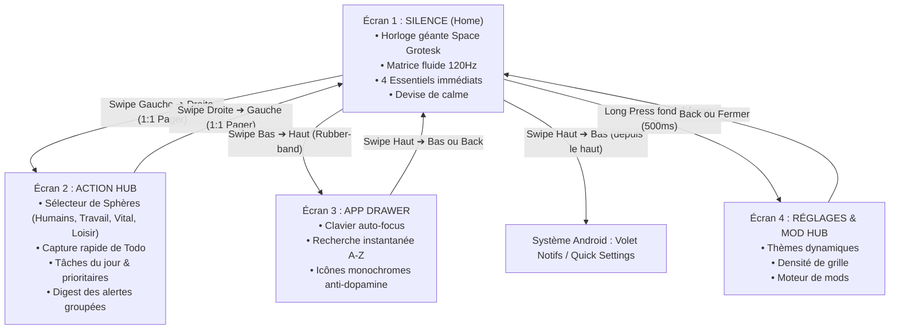
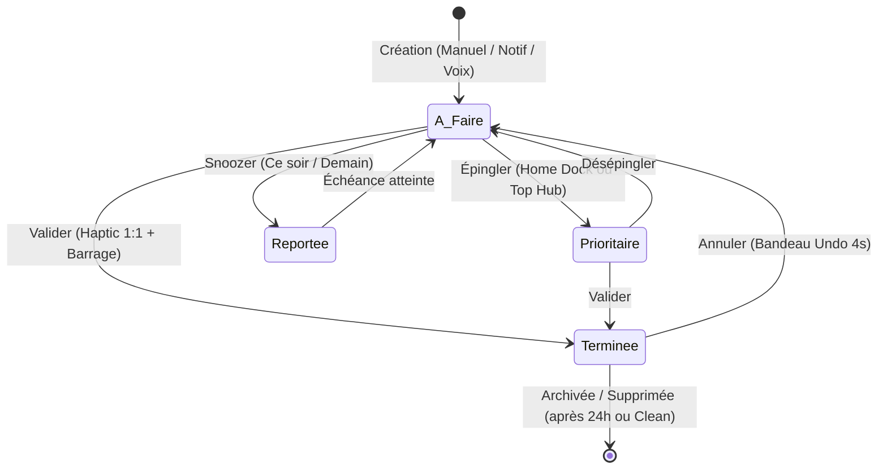

# Spécification Fonctionnelle & Technique : Navigation, Sphères de Vie & Todo Engine

> **Version :** 1.0.0 · **Date :** 2026-11-04  
> **Cible :** OSauce (The Sauce Launcher) · Android 14+ · Jetpack Compose · MVI & Room SQLite

---

## 1. Modèle Spatial Global & Navigation Gestuelle (Apple Fluid Design)

### 1.1 La Carte Mentale (Mental Map)
Pour préserver le calme mental et éliminer la surcharge cognitive des lanceurs traditionnels, la navigation d'OSauce repose sur **un repère spatial orthogonal 2D strict** :



### 1.2 Spécifications Gestuelles & Physique des Transitions

| Transition | Geste / Trigger | Physique & Courbe (Spring) | Comportement à l'interruption |
|---|---|---|---|
| **Silence $\leftrightarrow$ Action Hub** | Swipe horizontal 1:1 n'importe où sur l'écran | `HorizontalPager` Compose avec `snapAnimationSpec = spring(dampingRatio = 0.85f, stiffness = Spring.StiffnessMediumLow)`. Parallaxe 0.3x sur la matrice fluide. | **Interruptible à 100%** : un arrêt du doigt fige la page en cours, un flick inverse ramène instantanément en arrière. |
| **Silence $\rightarrow$ App Drawer** | Swipe vertical vers le haut depuis le tiers inférieur | `slideInVertically(spring(stiffness = Spring.StiffnessMedium))` combiné avec `scaleOut(0.96f)` du fond Home. | Rubber-banding progressif au-delà des bornes. |
| **App Drawer $\rightarrow$ Silence** | Swipe vers le bas ou bouton Retour | `slideOutVertically(tween(220, easing = FastOutLinearInEasing))` + `fadeIn` de l'horloge. | Sortie ultra-rapide (snappy exit, règle Emil Kowalski). |
| **Home $\rightarrow$ Settings / Mod Hub** | Appui long (500ms) sur une zone vide de la matrice | Micro-vibration haptique (40ms) + ouverture modale ascendante avec spring critically damped (`damping = 1.0f`). | Annulation instantanée si le doigt bouge de plus de 10dp avant les 500ms. |

---

## 2. Gestion des Groupes : Les « Sphères de Vie »

### 2.1 Philosophie
Une **Sphère de Vie** n'est pas un simple dossier d'applications : c'est un **contenant mental étanche** qui regroupe à la fois :
1. **Les applications associées** au contexte.
2. **Les tâches / actions à accomplir** liées à ce domaine.
3. **Les alertes & notifications entrantes** filtrées et silencieuses.

### 2.2 Les 4 Sphères Natives (Par Défaut)

Chaque sphère dispose de son identifiant textuel pur, de sa couleur d'accent et de son icône vectorielle dédiée (aucun emoji, aucun caractère ASCII de substitution) :

1. **Humains (Social & Liens)** :
   - *Icône vectorielle :* `UserGroupVector` (silhouette minimale deux personnes, traits fins 1.5dp).
   - *Couleur d'accent :* Émeraude apaisant (`#4ADE80`).
   - *Apps par défaut :* Téléphone, SMS/RCS, WhatsApp, Signal, Contacts.
   - *Rôle :* Répondre aux proches, planifier des appels, sans flux algorithmiques.

2. **Travail (Focus & Projets)** :
   - *Icône vectorielle :* `BriefcaseVector` (mallette géométrique épurée).
   - *Couleur d'accent :* Bleu acier / Indigo (`#60A5FA`).
   - *Apps par défaut :* Slack, Gmail/Outlook, Notion, Calendar, Drive, GitHub.
   - *Rôle :* Tâches à échéance, réunions, livrables, suivi des tickets.

3. **Vital (Urgences, Logistique & Quotidien)** :
   - *Icône vectorielle :* `PulseVector` (onde vitale / étincelle géométrique).
   - *Couleur d'accent :* Ambre chaleureux (`#FBBF24`).
   - *Apps par défaut :* Banques, Transports (SNCF, Uber, Métro), Santé (Doctolib), Maison/Domotique.
   - *Rôle :* Actions à impact immédiat (billet de train du jour, facture à régler, ordonnance).

4. **Loisirs (Culture, Détente & Déconnexion)** :
   - *Icône vectorielle :* `LeafVector` (courbe organique / feuille stylisée).
   - *Couleur d'accent :* Lavande / Violet doux (`#A78BFA`).
   - *Apps par défaut :* Musique, Podcasts, Liseuse/Kindle, Notes personnelles.
   - *Rôle :* Idées de lecture, projets créatifs, temps pour soi.

### 2.3 Capacités Personnalisables des Sphères
* **Création libre** : Bouton `+` pour ajouter une sphère personnalisée (ex: "Sport & Santé", "Études / Fac", "Side-Project").
* **Configuration unitaire** :
  - Nom & Icône vectorielle (ou Glyphe monochrome).
  - Couleur d'accent personnalisée (compatible thèmes OSauce).
  - Sélection des applications membres par cases à cocher dans la liste complète.
  - Règle de notification : *Silencieux complet* ou *Digest horaire/journalier*.
* **Réorganisation** : Glisser-déposer (Drag & Drop) des pilules de sphères pour changer leur ordre d'affichage.

---

## 3. Le Moteur de Tâches : « Todo & Action Engine »

### 3.1 Anatomie d'une Action
Chaque élément dans l'Action Hub est une **Action** avec un cycle de vie précis :



### 3.2 Champs et Structure de Données (Room Entity)
```kotlin
@Entity(tableName = "todos")
data class TodoEntity(
    @PrimaryKey val id: String = UUID.randomUUID().toString(),
    val sphereId: String,               // ID de la sphère rattachée
    val title: String,                   // Intitulé de la tâche (KISS, court)
    val notes: String? = null,           // Notes secondaires optionnelles
    val isCompleted: Boolean = false,    // Statut terminé
    val isPinned: Boolean = false,       // Épinglée en haut ou sur l'écran Home
    val priority: TodoPriority = TodoPriority.NORMAL, // LOW, NORMAL, HIGH, CRITICAL
    val dueTimestamp: Long? = null,      // Horodatage d'échéance (optionnel)
    val createdAt: Long = System.currentTimeMillis(),
    val completedAt: Long? = null,
    val sourcePackage: String? = null    // Package Android si créée depuis une notification
)
```

### 3.3 Interactions & Gestes Tactiles (Micro-détails Apple Design)
* **Tap Checkbox** :
  - Déclenchement sur `touch_down` : réduction de l'icône à `scale(0.85)` avec haptique légère (`HapticFeedbackType.TextHandleMove`).
  - Sur release : rebond spring à `1.0f`, remplissage de la coche avec l'accent de la sphère, texte barré avec transition alpha `0.4f`.
  - Bandeau discret "Annuler" (Undo) flottant pendant 4 secondes en bas de l'écran.
* **Swipe Horizontal sur la ligne de tâche** :
  - *Swipe vers la droite (Right Swipe)* : Terminer la tâche instantanément (icône verte de coche).
  - *Swipe vers la gauche (Left Swipe)* : Menu rapide Snooze (Reporter à ce soir 19h / Demain 9h / Week-end) ou Corbeille.
* **Capture Rapide en 1 Touche (Zero-Friction Quick Add)** :
  - Champ de saisie toujours visible en haut de l'Action Hub : `+ Ajouter une intention...`.
  - Si l'utilisateur est sur l'onglet "Travail", la tâche est automatiquement assignée à "Travail" sans boîte de dialogue encombrante.

---

## 4. Pont Magique : Des Notifications Android vers les Todos

### 4.1 Le Problème Actuel d'Android
Sur Android classique, 20 notifications WhatsApp ou Slack créent une panique visuelle : badge rouge, bannières, notifications individuelles qui poussent à ouvrir l'application et à scroller pendant 30 minutes.

### 4.2 La Solution OSauce : Le « Notification Digester »
1. **Interception silencieuse** via `NotificationListenerService`.
2. **Routage automatique par Sphère** selon le package (`com.whatsapp` $\rightarrow$ Sphère Humains, `com.slack` $\rightarrow$ Sphère Travail).
3. **Affichage groupé (Digest Card)** :
   ```text
   +-------------------------------------------------------+
   | 💬 WhatsApp  •  3 messages de Sarah                   |
   | "Tu viens au dîner ce soir ?" (14:32)                 |
   |                                                       |
   | [ ➔ Convertir en Todo ]   [ Ouvrir App ]   [ Marquer lu ] |
   +-------------------------------------------------------+
   ```
4. **1-Tap "Convertir en Todo"** :
   - Extrait le texte clé du message.
   - Crée une tâche dans la sphère : `[ ] Sarah : dîner ce soir`.
   - Acquitte la notification système Android pour nettoyer la barre d'état.

---

## 5. Wireframe Détaillé de l'Écran 2 (Action Hub)

```text
+--------------------------------------------------------------------------+
|  09:41                             OSAUCE HUB                            |
|                                                                          |
|  +--------------------------------------------------------------------+  |
|  | +  Ajouter une tâche dans Focus...                           [Entrée] |  <- Quick Capture
|  +--------------------------------------------------------------------+  |
|                                                                          |
|  [Tous]   [Humains (2)]   [Travail (4)]*   [Vital (1)]   [+]            |  <- Pilules Sphères
|  ----------------------------------------------------------------------  |
|                                                                          |
|  ACTIONS PRIORITAIRES (2)                                                |
|  +--------------------------------------------------------------------+  |
|  | (o) Préparer présentation projet Q4                  Aujourd'hui 17h|  |
|  +--------------------------------------------------------------------+  |
|  | (o) Renvoyer formulaire mutuelle                            Demain |  |
|  +--------------------------------------------------------------------+  |
|                                                                          |
|  FLUX DU JOUR (2)                                                        |
|  +--------------------------------------------------------------------+  |
|  | (o) Répondre au mail de Marc                                 14:00 |  |
|  +--------------------------------------------------------------------+  |
|  | (o) Relire pull request OSauce #12                                 |  |
|  +--------------------------------------------------------------------+  |
|                                                                          |
|  DIGEST DU JOUR (1 Alerte groupée)                                       |
|  +--------------------------------------------------------------------+  |
|  | Slack  •  #general (8 nouveaux messages non lus)                    |  |
|  | [ Convertir en Todo ]                        [ Tout marquer lu ]   |  |
|  +--------------------------------------------------------------------+  |
|                                                                          |
|                          • • (Indicateur Pager 2/2)                      |
+--------------------------------------------------------------------------+
```

---

## 6. Architecture Technique & Roadmap d'Implémentation

### 6.1 Découpage des Modules & Couches

```text
com.osauce.launcher
├── data
│   ├── local
│   │   ├── OSauceDatabase.kt         (Room DB)
│   │   ├── dao/
│   │   │   ├── SphereDao.kt          (CRUD Sphères & requêtes Flow)
│   │   │   ├── TodoDao.kt            (CRUD Todos, filtrage par statut/date)
│   │   │   └── NotificationLogDao.kt (Digest d'alertes locales)
│   │   └── entity/
│   │       ├── SphereEntity.kt
│   │       └── TodoEntity.kt
│   └── repository/
│       ├── SphereRepository.kt       (Interface & Impl réactive)
│       └── TodoRepository.kt         (Interface & Impl réactive)
├── feature
│   ├── hub/
│   │   ├── ActionHubScreen.kt        (Composant principal de l'écran 2)
│   │   ├── ActionHubViewModel.kt     (State holder MVI pour l'Action Hub)
│   │   ├── ActionHubUiState.kt       (State immuable : sphères, todos, filtre actif)
│   │   └── components/
│   │       ├── SphereSelectorRow.kt  (Rangée défilante des pilules de sphères)
│   │       ├── QuickCaptureBar.kt    (Barre d'ajout rapide instantanée)
│   │       ├── TodoItemRow.kt        (Ligne de tâche interactive avec swipe/haptique)
│   │       ├── NotificationDigestCard.kt (Carte d'alertes groupées avec conversion)
│   │       └── EditSphereDialog.kt   (Modale de personnalisation de sphère)
│   └── pager/
│       └── MainHorizontalPager.kt    (Conteneur Pager 1:1 reliant Silence <-> Hub)
```

### 6.2 Dépendances Requises (Gradle Version Catalog)
* `androidx.room:room-runtime` & `androidx.room:room-ktx` (v2.6.1 ou v2.7)
* Plugin `com.google.devtools.ksp` pour la génération des DAO Room sans latence Kapt.
* Compose Foundation Pager (`HorizontalPager`, déjà inclus dans Jetpack Compose 1.7+).

---

## 7. Critères d'Acceptation & Checklist de Qualité

- [ ] **Fluidité 120 FPS** : Zéro jank ou frame drop lors du swipe horizontal entre Home et Action Hub sur écran 120Hz (Samsung S22/S24).
- [ ] **Zéro Latence Saisie** : Ajout d'une todo en moins de 100ms avec mise à jour immédiate de la liste via `Flow`.
- [ ] **Persistance Déterministe** : Aucune perte de données de tâches lors des redémarrages ou mises à jour d'APK (Room SQLite sous `/data/data/com.osauce.launcher/databases/`).
- [ ] **Ergonomie Tactile Pure** : Retours haptiques nets sur chaque coche et glissement.
- [ ] **Confidentialité Totale (FOSS)** : Toutes les données de tâches et de notifications restent 100% locales sur l'appareil, sans aucun appel réseau vers des serveurs tiers.

