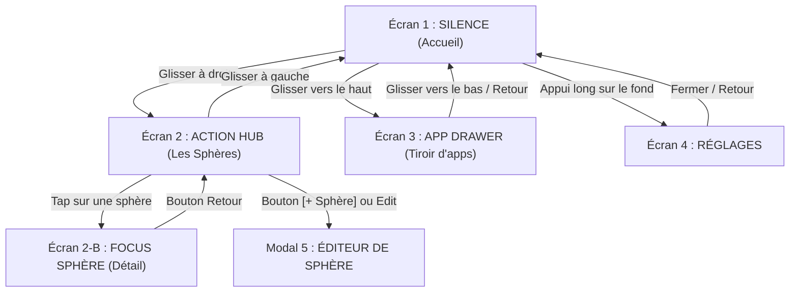

# Spécification des Écrans & Fonctionnalités (OpenSauce Natif)

Description concrète de chaque écran par défaut d'OpenSauce, de ses composants et de ses interactions.

---

## 1. Schéma des Écrans

---

## 2. Détail des Écrans

### Écran 1 : SILENCE (Accueil)
* **Horloge** : Grande horloge lisible. Clic dessus pour afficher ou masquer les secondes.
* **Jauge d'autonomie** : Fin trait horizontal sous l'horloge indiquant le niveau de batterie sans chiffres.
* **Fond réactif** : Matrice qui réagit au toucher (vagues et traînées au glisser). Physique fluide qui s'adapte automatiquement au taux de rafraîchissement de l'écran du téléphone.
* **Phrase personnalisée** : Texte court sous l'horloge.
* **Dock 4 essentiels** : Téléphone, Messages, Caméra, Applications.

### Écran 2 : ACTION HUB (Dashboard des Sphères)
* **En-tête** : Titre + bouton visible `[ + Sphère ]` en haut à droite.
* **Cartes de Sphères (2 colonnes)** :
  - Sphères par défaut (*Humains*, *Travail*, *Vital*, *Loisirs*) et sphères personnalisées.
  - Chaque carte affiche :
    * Nom et couleur d'accent.
    * Symbole géométrique vectoriel (zéro emoji).
    * Nombre de tâches en cours.
    * Raccourcis des applications associées à la sphère.
    * Bouton d'options / édition sur la carte.
  - Carte `[ + Créer une sphère ]` en fin de grille.
* **Saisie rapide (Quick Capture)** : Champ texte avec bouton `+` pour ajouter une tâche ou une note.
* **Tâches en cours** :
  - Clic case : ligne qui se barre progressivement.
  - Glisser vers la droite : termine la tâche.
  - Glisser vers la gauche : supprime la tâche.

### Écran 2-B : FOCUS SPHÈRE (Détail)
* Quand on clique sur une carte :
  - Bouton retour vers la vue d'ensemble.
  - Nom et couleur de la sphère.
  - Applications de la sphère : seules les applications utiles à ce contexte s'affichent, lançables directement en 1 tap.
  - Tâches spécifiques à ce domaine.

### Écran 3 : APP DRAWER (Tiroir d'applications)
* Champ de recherche avec ouverture automatique du clavier.
* Rail alphabétique A-Z sur la droite pour naviguer vite.
* Liste claire des applications installées.
* Indicateur discret de la sphère à laquelle appartient l'application.
* Appui long sur une app : raccourci pour l'assigner à une sphère.

### Écran 4 : RÉGLAGES
* Bouton pour définir OSauce comme lanceur par défaut Android.
* Réglages du fond interactif : intensité, forme des points, densité, effets au toucher.
* Thèmes de couleurs d'accent.
* Modification de la phrase sous l'horloge.

### Modal 5 : ÉDITEUR DE SPHÈRE
* Nom de la sphère.
* Choix de couleur parmi 8 teintes sobres.
* Choix du symbole vectoriel (8 icônes).
* Liste des applications installées avec cases à cocher pour choisir les membres.
* Bouton supprimer (pour les sphères personnalisées).
