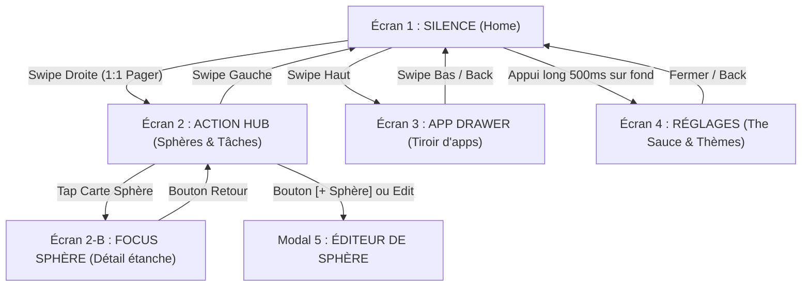

# Spécification Complète des Écrans & Fonctionnalités (OpenSauce Natif)

Ce document détaille chaque écran par défaut d'OpenSauce (sans aucun plugin externe), les composants exacts qui s'y trouvent, et les interactions utilisateur.

---

## 1. Arborescence Spatiale & Interactions

---

## 2. Fiche Technique de Chaque Écran

### Écran 1 : SILENCE (Accueil)
* **But** : Éliminer la surcharge visuelle et mentale dès le déverrouillage du téléphone.
* **Éléments affichés** :
  1. **Horloge Space Grotesk** : Chiffres géants (96sp), toggle des secondes par simple clic sur l'horloge.
  2. **Jauge de batterie Canvas** : Trait vectoriel horizontal épuré indiquant le niveau sans pourcentage anxiogène.
  3. **Matrice « The Sauce »** : Fond dynamique 15x32 (480 cellules) réagissant aux vortex d'ondes et aux touches tactiles (vagues de couleur et gerbes de particules 120Hz).
  4. **Devise de calme** : Texte minimaliste personnalisable (ex: *"Un seul pas à la fois"*).
  5. **Dock 4 Essentiels** : Raccourcis immédiats (Téléphone, Messages, Caméra, Apps) avec micro-scale tactile (0.94x) sans ripple Material.
* **Gestes** :
  - Swipe droite $\rightarrow$ Ouvre l'Action Hub (Pager 1:1 interruptible).
  - Swipe haut $\rightarrow$ Ouvre le tiroir d'applications.
  - Appui long (500ms) sur le fond $\rightarrow$ Ouvre les Réglages.

---

### Écran 2 : ACTION HUB (Dashboard des Sphères)
* **But** : Vue synthétique de ses domaines de vie, sas mental d'action sans distraction.
* **Éléments affichés** :
  1. **En-tête Action** : Titre `ACTION HUB` + sous-titre `Sphères de Vie` + bouton visible `[ + Sphère ]` en haut à droite.
  2. **Grille de Cartes de Sphères (`SphereCard` en 2 colonnes)** :
     - Cartes modulaires pour les 4 sphères natives (*Humains, Travail, Vital, Loisirs*) et les sphères personnalisées.
     - Chaque carte affiche :
       * Halo et bordure colorée selon l'accent (`#4ADE80`, `#60A5FA`, `#FBBF24`, `#A78BFA`).
       * Grande icône vectorielle géométrique originale (traits fins 1.5dp, zéro emoji).
       * Nom de la sphère en typo Space Grotesk.
       * Compteur de tâches actives (ex: `2 tâches`).
       * Raccourcis des applications associées à la sphère (ex: Slack/Mail pour Travail).
       * Bouton d'édition rapide sur la carte.
     - Carte spéciale `[ + Créer une sphère ]` en bordure pointillée pour ajout immédiat.
  3. **Barre de Capture Rapide (Quick Capture)** :
     - Champ de saisie universel avec bouton `+` pour noter instantanément une intention ou tâche.
  4. **Tâches Prioritaires** :
     - Liste interactive des tâches.
     - Rebond tactile spring sur la pastille circulaire.
     - Traçage dynamique en temps réel de la ligne de strikethrough (gauche à droite).
     - Swipe droite pour terminer (avec rebond élastique).
     - Swipe gauche pour supprimer.

---

### Écran 2-B : FOCUS SPHÈRE (Détail d'une Sphère)
* **But** : Travailler ou vivre dans un domaine précis sans être pollué par les autres.
* **Éléments affichés** :
  1. **Barre de titre & retour** : Bouton `← Toutes les sphères`, nom et couleur de la sphère active, bouton paramètres.
  2. **Dock d'applications de la sphère** : Les seules applications autorisées et nécessaires pour ce contexte (ex: Slack et Gmail si Travail).
  3. **Capture rapide ciblée** : Toute tâche ajoutée ici est automatiquement enregistrée sous cette sphère.
  4. **Liste des tâches du domaine** : Tâches en cours et tâches terminées propres à cette sphère.

---

### Écran 3 : APP DRAWER (Tiroir d'applications)
* **But** : Lancer une application par recherche intentionnelle en moins de 2 secondes.
* **Éléments affichés** :
  1. **Barre de recherche rapide** : Clavier auto-focus pour filtrer instantanément au texte.
  2. **Rail alphabétique A-Z** : Tranche tactile sur le côté droit pour navigation rapide d'une lettre à l'autre.
  3. **Liste d'applications monochromes** : Icônes traitées en noir & blanc via `ColorMatrix` GPU (neutralisation des stimuli dopaminergiques).
  4. **Pastilles de sphère** : Indicateur de couleur discret montrant à quelle sphère de vie l'application appartient.
  5. **Menu contextuel (Appui long)** : Assigner à une sphère, ouvrir les infos système, désinstaller.

---

### Écran 4 : RÉGLAGES & THE SAUCE
* **But** : Personnaliser l'expérience sans bloatware.
* **Éléments affichés** :
  1. **Définir comme Launcher par défaut** : Bouton système direct `ACTION_HOME_SETTINGS`.
  2. **Contrôles de la Matrice « The Sauce »** :
     - Vibrance : Subtile, Équilibrée, Éclatante.
     - Forme des cellules : Carrés adoucis, Cellules organiques, Croix matrice (+).
     - Densité : Normal (15x32), Dense (20x42), Aéré (10x21).
     - Toggles particulaires : Gerbes au toucher, Traînée au glisser (*Drag Trail*).
  3. **Sélecteur de Thèmes OLED** : Presets OLED Dark, Phosphore Vert, Cyber Ambre, Papier Mono, Violet Profond.
  4. **Personnalisation** : Modification de la devise de calme et affichage des secondes.

---

### Modal 5 : ÉDITEUR / CRÉATEUR DE SPHÈRE (`EditSphereDialog`)
* **But** : Créer ou éditer une sphère de vie en quelques secondes.
* **Éléments affichés** :
  1. **Nom de la sphère** : Champ texte (ex: *Finances, Santé, Famille, Studio*).
  2. **Palette de 8 couleurs d'accent** : Sélection tactile circulaire.
  3. **Sélecteur de 8 symboles vectoriels** : Icônes originales (Utilisateurs, Mallette, Onde vitale, Feuille, Étoile, Bouclier, Terminal, Boussole).
  4. **Attribution des applications** : Liste des applications installées du téléphone avec cases à cocher pour définir les apps membres.
  5. **Bouton de suppression** : Pour les sphères personnalisées (protège les 4 sphères natives).
