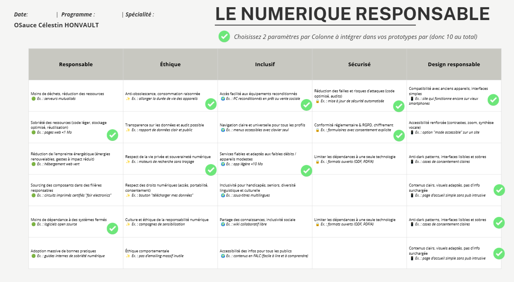

# Grille d'Évaluation - Le Numérique Responsable (10 Paramètres Clés) - OpenSauce (O.Sauce)

Ce document formalise la sélection des 10 paramètres de Numérique Responsable (2 par colonne) à cocher avec des pastilles vertes sur la grille d'évaluation, ainsi que les justifications techniques associées au Launcher sobre **OpenSauce (Aka O.Sauce)**.

---

## Synthèse Visuelle des 10 Pastilles Vertes

| Colonne | Paramètre 1 Sélectionné | Paramètre 2 Sélectionné |
| :--- | :--- | :--- |
| **1. Responsable** | **Sobriété des ressources** (code léger, APK ~15 Mo, zéro wakelock parasite) | **Moins de dépendance à des systèmes fermés** (100% open source, F-Droid) |
| **2. Éthique** | **Anti-obsolescence, consommation raisonnée** (allonger la vie des téléphones de 3 ans) | **Respect de la vie privée et souveraineté** (traitement local, zéro pistage) |
| **3. Inclusif** | **Accès facilité aux équipements reconditionnés** (packs smartphones reconditionnés éthiques) | **Services fiables et adaptés aux appareils modestes** (fluide dès Android 9) |
| **4. Sécurisé** | **Réduction des failles et risques d'attaques** (sécurité matérielle et chiffrement préservés) | **Conformité réglementaire & RGPD** (Privacy by Design, zéro donnée collectée) |
| **5. Design responsable** | **Compatibilité avec anciens appareils, interface économe** (rendu 60/120 FPS sur GPU modeste) | **Anti-dark patterns, interfaces lisibles et sobres** (zéro badge rouge, fond OLED pur) |

---

## Justifications Détaillées par Colonne (Arguments Oral / Soutenance)

### Colonne 1 : Responsable

1. **Pastille 1 : Sobriété des ressources (code léger, stockage optimisé, réutilisation)**
   * *Application concrète dans OpenSauce* : Binaire applicatif compact (APK ~15 Mo contre plusieurs gigaoctets pour les surcouches constructeurs). Code natif Kotlin avec Jetpack Compose optimisé pour minimiser l'usage du CPU et de la RAM. Zéro service d'arrière-plan caché, zéro wakelock parasite réveillant l'appareil en veille.
2. **Pastille 2 : Moins de dépendance à des systèmes fermés (logiciels open source)**
   * *Application concrète dans OpenSauce* : Projet 100% libre et gratuit (licence open source) distribué via F-Droid et en téléchargement direct. Ne crée aucune dépendance à des services publicitaires propriétaires et n'enferme pas l'utilisateur dans un écosystème commercial fermé.

### Colonne 2 : Éthique

1. **Pastille 1 : Anti-obsolescence, consommation raisonnée (allonger la durée de vie des appareils)**
   * *Application concrète dans OpenSauce* : Remplacement de l'écran d'accueil alourdissant des constructeurs (Samsung OneUI, Xiaomi MIUI) par une interface fluide qui redonne une seconde jeunesse aux smartphones de 3 à 5 ans sans nécessiter l'achat d'un nouveau terminal.
2. **Pastille 2 : Respect de la vie privée et souveraineté numérique (sans traçage)**
   * *Application concrète dans OpenSauce* : Traitement 100% local des alertes via le service natif `NotificationListenerService`. Zéro SDK publicitaire, zéro télémétrie commerciale, aucune notification ni donnée d'usage n'est transmise sur des serveurs distants.

### Colonne 3 : Inclusif

1. **Pastille 1 : Accès facilité aux équipements reconditionnés (appareils reconditionnés)**
   * *Application concrète dans OpenSauce* : Partenariats avec des reconditionneurs solidaires pour proposer des packs clés en main abordables (120 à 150 €) prééquipés d'OpenSauce, offrant une alternative concrète et éthique aux smartphones neufs à 800 € pour les étudiants et foyers modestes.
2. **Pastille 2 : Services fiables et adaptés aux appareils modestes / faibles débits**
   * *Application concrète dans OpenSauce* : Fonctionne sans aucune latence sur des terminaux d'entrée de gamme ou anciens (dès Android 9). Ne dépend pas d'une connexion permanente en 5G pour afficher l'interface ou gérer les tâches quotidiennes.

### Colonne 4 : Sécurisé

1. **Pastille 1 : Réduction des failles et risques d'attaques (sécurité matérielle intacte)**
   * *Application concrète dans OpenSauce* : Contrairement aux installations d'OS alternatifs qui obligent à déverrouiller le bootloader (brisant le chiffrement matériel sécurisé et les protections Knox / Titan M), OpenSauce s'installe comme un Launcher applicatif standard. **Le cloisonnement de sécurité (sandbox) et le chiffrement matériel natif d'Android restent intacts à 100%.**
2. **Pastille 2 : Conformité réglementaire & RGPD, chiffrement**
   * *Application concrète dans OpenSauce* : Conception stricte *Privacy by Design*. Aucune base de données d'utilisateurs nominative n'est créée, aucune autorisation réseau inutile n'est demandée pour le fonctionnement du launcher.

### Colonne 5 : Design responsable

1. **Pastille 1 : Compatibilité avec anciens appareils, interfaces simples**
   * *Application concrète dans OpenSauce* : Rendu vectoriel moderne accéléré matériellement sur GPU, garantissant une fluidité de 60 à 120 FPS même sur des puces graphiques éprouvées.
2. **Pastille 2 : Anti-dark patterns, interfaces lisibles et sobres (zéro surcharge cognitive)**
   * *Application concrète dans OpenSauce* : Écran « Le Silence » sur fond noir OLED pur (`#000000`) qui éteint physiquement les sous-pixels de la dalle pour réduire la fatigue oculaire et la consommation de batterie. Éradication des pastilles rouges anxiogènes (triggers dopaminergiques) et remplacement du flux infini par un Hub d'Action structuré par sphères de vie.
